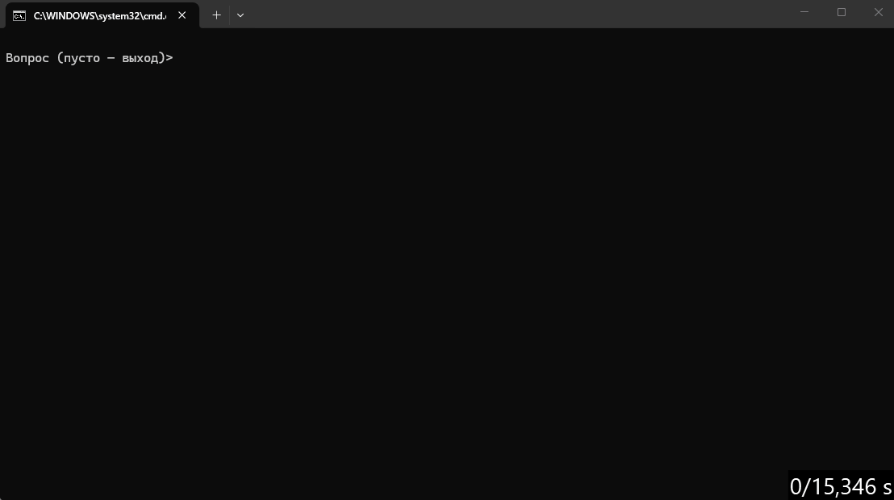
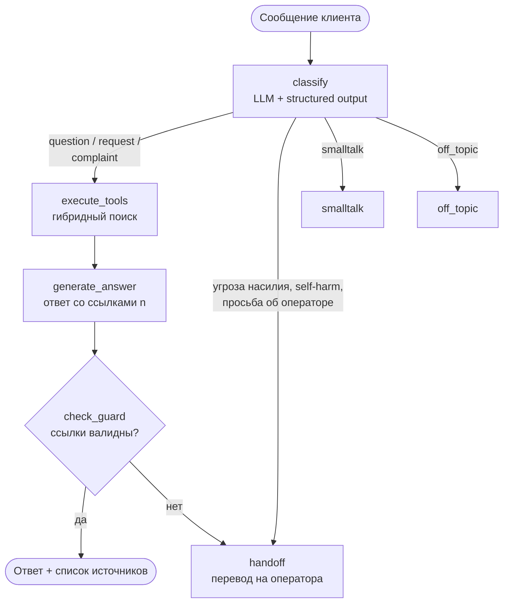
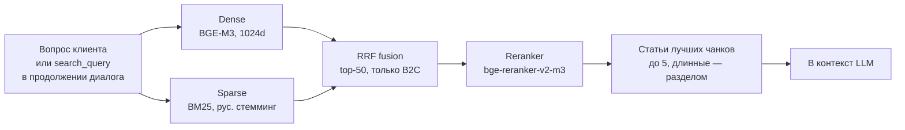
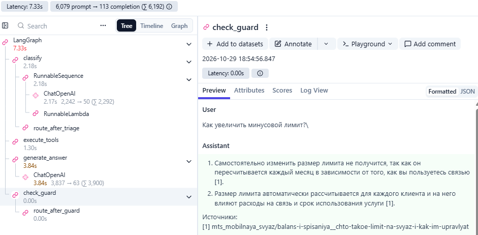

# SupportAgent: RAG-агент первой линии поддержки оператора связи


Агент на LangGraph, который сначала **классифицирует** обращение клиента, а потом
либо отвечает по базе знаний **со ссылками на источники**, либо переводит
на оператора. База знаний собрана из ~2 300 публичных статей support.mts.ru.
Весь стек работает локально на одной потребительской видеокарте
(AMD RX 6700 XT, Vulkan), без платных API.

> **Аналитическая часть:** [выжимка на одну страницу](docs/summary.pdf)
> и полная [бизнес-постановка](docs/business-case.md): процесс AS-IS / TO-BE в BPMN,
> бизнес-правила, требования, связь метрик с рисками, журнал решений, план пилота
> и оценка эффекта.




**Что показывает проект:** агентный граф с детерминированной маршрутизацией,
гибридный поиск с реранкером и фильтром сегмента, защиту от ответов без источника
и, главное, оценку качества по слоям: поиск, классификатор и итоговый ответ отдельно.

**Результаты:**

| Слой | Метрика | Значение |
|---|---|---|
| Поиск: абзац с ответом попал в контекст LLM | AnswerHit@LLM | **91%** (97/107), 95% ДИ 84–95% |
| Поиск: чужие сегменты (B2B, банк) в контексте | OffSegment@LLM | 15% → **0%** после фильтра B2C |
| Триаж: маршрут обращения | точность | **97%** (152/156)¹ |
| Триаж: эскалации к оператору | recall / ложные | **100%** (32/32) / 0%¹ |
| Ответ: утверждения подтверждены контекстом | claim precision | **96%** (192/199)² |
| Ответ: ни одного неподтверждённого утверждения | доля ответов | 79% (23/29), 95% ДИ 62–90%² |
| Ответ: отказ, хотя ответ был в контексте | доля вопросов с ответом в базе | **39%** (11/28)² |
| Время ответа | p50 / p95 | 16.2 / 26.8 с |

¹ Промпт триажа дорабатывался на этом же наборе, отложенной тестовой выборки пока нет.
² Прогон от 27.10, разметка LLM-судьёй. Эталонных ответов в наборе нет, согласие судьи с человеком не измерено.

**Главный вывод из оценки:** первая метрика поиска (Hit@5 = 98%) оказалась
завышенной. После перехода на метрику по абзацу и фильтра сегмента поиск
находит ответ в 91% случаев, и узкое место сместилось в генерацию.
Доработка промпта генерации (прогоны 26.10 и 27.10, менялся только промпт)
снизила долю ответов с неподтверждёнными утверждениями с 41% до 21%,
но подняла долю ложных отказов с 14% до 39%:
модель стала реже выдумывать и чаще отказываться там, где ответ был
в контексте. Подробнее в разделах
[Как я нашёл, что метрика поиска завышена](#как-я-нашёл-что-метрика-поиска-завышена)
и [Сквозная оценка ответа](#3-сквозная-оценка-ответа-54-вопроса-через-весь-граф).

> Все eval-наборы синтетические: запросы и диалоги сгенерированы LLM,
> релевантность и корректность ответов тоже размечены LLM-судьёй.
> Подробнее об этом в [ограничениях](#ограничения-и-планы).

---

## Содержание

- [Какую задачу решает](#какую-задачу-решает)
- [Как это работает](#как-это-работает)
- [Ключевые инженерные решения](#ключевые-инженерные-решения)
- [Оценка качества](#оценка-качества)
- [Стек](#стек)
- [Запуск](#запуск)
- [Структура репозитория](#структура-репозитория)
- [Ограничения и планы](#ограничения-и-планы)

---

## Какую задачу решает

В чат поддержки приходят очень разные сообщения: справочные вопросы, просьбы
что-то подключить, жалобы на сбои, «спасибо», спам и иногда угрозы.
Обычный RAG-бот отвечает на всё одинаково: ищет в базе и генерирует ответ.
Получается два риска:

1. **Бот отвечает там, где нужен человек.** Угроза, заявление о намерении
   навредить себе или прямая просьба позвать оператора не должны уходить
   в генерацию.
2. **Бот выдумывает.** Если в документации нет ответа, LLM всё равно
   сочинит правдоподобный.

SupportAgent закрывает оба риска на уровне архитектуры, а не промпта:
маршрутизацию делает отдельный классификатор, а ответ без проверяемой
ссылки на источник не доходит до пользователя. Насколько хорошо это
работает, измерено сквозной оценкой (см. ниже), и там же видно, где
архитектурной защиты недостаточно.

## Как это работает



### 1. Триаж

Узел `classify` размечает **последнее** сообщение с учётом 6 предыдущих реплик
(чтобы «а на 50?» понималось как продолжение вопроса). Модель возвращает
строгий JSON по Pydantic-схеме:

```python
class Triage(BaseModel):
    reason: str          # обоснование, заполняется первым (лёгкий chain-of-thought)
    intent: Literal["question", "request", "complaint", "smalltalk", "off_topic"]
    wants_operator: bool
    threat: Literal["none", "violence", "self_harm", "legal"]
    search_query: str    # самостоятельный вопрос для поиска, с учётом истории
```

Поле `search_query` превращает продолжение диалога («а на 50?») в полный
вопрос для поиска. Отдельного вызова LLM для этого нет: триаж уже видит
историю, поэтому переписывает запрос заодно.

Маршрут выбирается детерминированно, кодом (`route_after_triage`), а не моделью.
Угроза насилия, self-harm или явная просьба позвать оператора уводят
обращение к человеку. При self-harm агент дополнительно показывает номер
экстренной помощи. Если классификатор упал, запрос идёт в RAG: лучше
попытаться ответить, чем молча потерять обращение.

**Жалобы идут в RAG, а не сразу к оператору.** Большая часть жалоб в
поддержке связи («нет сети после смены телефона», «списывают за подписку»)
закрывается инструкцией из базы знаний. Поэтому жалоба сначала получает
ответ по документации, а если обоснованного ответа нет, guard переводит
диалог на оператора. `intent=complaint` при этом сохраняется в состоянии
и в трейсе Langfuse: его можно использовать для приоритизации или
отдельной метрики, не меняя граф.

Промпт триажа отделён от кода (`src/prompts/*.yaml`). В нём отдельно
разобраны трудные случаи: эмоции и гиперболы («убил бы за такой интернет»
не угроза), граница между вопросом, просьбой и жалобой, попытки prompt injection.

### 2. Поиск



Поиск идёт по чанкам, а модель получает статьи, из которых они взяты:
чанк хорошо находится, но инструкция без начала и конца статьи теряет
условия. Длинная статья передаётся не целиком, а разделом с найденным чанком.

Обе ветки поиска фильтруются по полю `segments = b2c` в payload Qdrant:
статьи для бизнеса и банка частному абоненту не показываются. Сегмент
определяется по папке статьи (`src/ingestion/segment.py`).

Поиск вынесен в `src/agent/retrieval.py` и ничего не знает про LangGraph.
Строка запроса на входе, список фрагментов на выходе. Этот же модуль использует
eval, поэтому метрики измеряют ровно тот код, который работает в агенте.
Если реранкер недоступен, агент деградирует до топа по RRF, а не падает.

### 3. Генерация и guard

LLM получает пронумерованные фрагменты и обязана ставить у каждого
утверждения ссылку вида `[2]`. Затем `check_guard` проверяет ответ:

- в ответе есть хотя бы одна ссылка;
- все ссылки указывают на реально переданные фрагменты (нет `[7]` при пяти фрагментах).

Если проверка не прошла, ответ **не отправляется**, а диалог уходит
оператору. К прошедшему ответу автоматически добавляется список
статей-источников. Guard проверяет форму, а не смысл: сквозная оценка
показала, что ответ с правильной ссылкой всё равно может исказить
содержание фрагмента. Это главное направление следующей итерации.

## Ключевые инженерные решения

| Решение | Почему |
|---|---|
| **BGE-M3 вместо FRIDA** для эмбеддингов | FRIDA построена на T5-энкодере. Под llama.cpp с CLS-пулингом она выдавала косинусную близость 1.0 для любой пары текстов. Заметил это при проверке эмбеддингов и сменил модель. |
| **Гибридный поиск: dense + BM25 через RRF** | Пользователи пишут с опечатками и сленгом («скока стоит пеедать гиги»), а в статьях точные названия тарифов и услуг. Dense ловит смысл, BM25 точные термины. Реранкер поверх гибрида дал лучший результат из всех вариантов (см. таблицу ниже). |
| **Трёхуровневый чанкинг** | Сначала по заголовкам `##/###/####` с сохранением пути заголовков, потом по нумерованным спискам (не разрывать инструкцию), и только потом рекурсивно по токенам с overlap. Лимит 1024 токена под контекст реранкера. |
| **Contextual prefix при эмбеддинге** | К тексту чанка при векторизации добавляется `продукт > раздел > статья > заголовки`. Короткий чанк вроде «отключите эту опцию в приложении» находится по смыслу. В payload хранится чистый текст, LLM префикс не видит. |
| **Искать по чанкам, отдавать статьи** | Короткий чанк лучше находится, но вырванный шаг инструкции теряет условия. Сначала в LLM уходили чанки с соседями (по 800 символов), теперь статьи найденных чанков; длинные статьи передаются разделом. Вход генерации при этом не превышает ~4 600 токенов из 8 192. |
| **Фильтр сегмента B2C** | Сквозная оценка показала, что модель выдаёт частному абоненту условия из статей МТС Бизнес. Фильтр по полю `segments` в Qdrant убрал чужие сегменты из контекста полностью (OffSegment 15% → 0%) и поднял AnswerHit@LLM на golden set v4 с 90% до 95%. |
| **Переписывание запроса в триаже** | Поиск видел только последнюю реплику, поэтому «а на 50?» искалось без контекста. Триаж уже читает историю и вызывает LLM, так что самостоятельный поисковый запрос он пишет заодно, без лишнего вызова. Сначала поиск шёл по обоим запросам, но на самостоятельных вопросах переформулировка починила 3 запроса и сломала 6 (после правки промпта 2 и 3). Поэтому переписанный запрос заменяет исходный только в продолжении диалога. Эффект на продолжениях пока не измерен. |
| **Дедупликация чанков** | Одинаковые блоки текста повторяются в разных статьях МТС. Остаётся одна копия, но все источники, продукты и разделы сохраняются в списках, поэтому фильтры и поиск соседей продолжают работать. |
| **Источник данных: `__NEXT_DATA__`, а не вёрстка** | Статьи берутся из JSON Next.js-страницы и конвертируются в Markdown с YAML-frontmatter. Получается чистый текст без меню и футеров. Trafilatura для этой задачи не подошла. |
| **Решение о маршруте принимает код** | LLM только размечает, ветвление делает `route_after_triage`. Так поведение воспроизводимо, а метрики считаются по каждому полю отдельно. Политику маршрутизации можно менять без переобучения и перепромптинга классификатора. |
| **Жалобы сначала в RAG** | Раньше любая жалоба уходила оператору. Граница request / complaint размыта даже для человека («верните деньги за подписку»), и классификатор ошибался на ней чаще всего, а каждая ошибка означала лишний перевод. Теперь эскалация зависит только от сигналов, которые модель различает надёжно (угроза насилия, self-harm, просьба об операторе), а жалобу сначала пытается закрыть база знаний. |
| **Защита от prompt injection в триаже** | История передаётся внутри `<dialog>` как данные. Теги, которые пользователь пытается закрыть, вырезаются. В промпте явно сказано, что команды внутри диалога не выполняются. |
| **Оценка по слоям** | Поиск, триаж и итоговый ответ оцениваются отдельными наборами и скриптами. Так видно, какой слой виноват в ошибке, а не только что ответ плохой. |
| **Всё локально** | LLM (Qwen3.5-9B Q4_K_M через KoboldCpp), эмбеддер и реранкер (GGUF через llama-server) работают на AMD GPU через Vulkan, без CUDA и платных API. Внешняя LLM (GigaChat) используется только офлайн, для разметки eval-наборов. |

## Оценка качества

Агент оценивается на трёх уровнях: поиск, триаж и сквозной ответ.
У каждого уровня свои ошибки и свои способы их исправлять.

**Откуда данные.** Все наборы синтетические: запросы и диалоги сгенерированы
LLM в стиле реальных клиентов (опечатки, сленг, разговорные формулировки,
эмоции). Реальных обращений у меня нет, поэтому цифры ниже показывают
сравнение вариантов архитектуры на одном наборе, а не качество в продакшене.

### 1. Поиск

Главный набор, **chunk_first**, построен без участия поиска: сначала
выбирается абзац из базы, затем GigaChat пишет к нему вопрос клиента
без слов из заголовка статьи. Так правильный ответ известен заранее и не
зависит от того, что нашёл сам поиск. 107 вопросов, из них 29 с ответом
в форме отрицания («самостоятельно изменить нельзя»).

Метрика — **AnswerHit@k**: есть ли среди k первых результатов сам абзац
с ответом, а не любой фрагмент той же статьи.

| Этап | AHit@1 | AHit@3 | AHit@5 | AHit@50 | MRR |
|---|---|---|---|---|---|
| dense (BGE-M3) | 42% | 67% | 76% | 97% | 0.569 |
| sparse (BM25) | 27% | 42% | 50% | 79% | 0.374 |
| hybrid (RRF) | 47% | 71% | 79% | 97% | 0.610 |
| dense + rerank | 58% | 83% | 91% | 97% | 0.707 |
| **hybrid + rerank** | **62%** | **83%** | **92%** | **97%** | **0.739** |
| search → LLM (что реально уходит в модель) | 64% | 88% | 91% | 91% | 0.752 |

| Метрика | Значение |
|---|---|
| AnswerHit@LLM (абзац ушёл в контекст модели) | **91%** (97/107), 95% ДИ 84–95% |
| — вопросы с отрицанием / остальные | 86% / 92% |
| OffSegment@LLM (B2B и банк в контексте) | 15% до фильтра → **0%** после |
| Context precision (документы с оценкой ≥ 2) | 55%, оценка снизу |

Что видно из таблиц:
- **Основную работу делает реранкер:** AHit@5 у dense 76%, после реранка 91%.
- **BM25 почти ничего не добавляет:** сам по себе он слаб (AHit@50 79%),
  а hybrid + rerank лучше dense + rerank лишь на 1 п.п. Это в пределах шума,
  и я оставил BM25 ради точных названий услуг, а не ради цифры.
- **Слабое место — вопросы с отрицанием** (86%): клиент спрашивает «как
  увеличить лимит», а в базе написано «самостоятельно изменить нельзя».
- **10 промахов:** в 3 абзаца нет среди 50 кандидатов, в 5 реранкер ставит
  его на 7–20 место, ещё в 2 абзац был в топ-3, но не попал в выбранный
  раздел длинной статьи. Часть вопросов недоопределена («эту подписку»).
- **Порог реранкера не подобран:** скоры вопросов с ответом и без перекрываются,
  поэтому отказ «в базе этого нет» оставлен на LLM.

Набор пока не проверен вручную целиком, поэтому 91% — оценка снизу:
у части абзацев в базе есть дубли, которые метрика засчитывает как промах.

### Как я нашёл, что метрика поиска завышена

Первая версия eval показывала Hit@5 = 98% на golden set из 54 запросов.
При этом простой вопрос «как увеличить лимит задолженности» получал
ответ про кредитный лимит по банковской карте.

Трассировка (`tests/trace_query.py`) показала, где теряется ответ:
нужный абзац («самостоятельно изменить размер лимита не получится»)
стоял на 65-м месте в dense и не попадал в пул реранкера. С формулировкой
из базы («можно ли самостоятельно увеличить Лимит на связь») он был первым
на всех этапах. Индекс в порядке, проблема в словаре клиента.

Разбор показал три причины завышения:
1. **Hit@k считала попадание по статье:** засчитывался любой абзац
   релевантной статьи, даже если ответа в нём нет.
2. **Судья засчитывал статьи для бизнеса и банка** как ответ частному абоненту.
3. **Pool bias:** правильные ответы размечались по выдаче того же поиска,
   поэтому статья, которую поиск не нашёл, не могла стать правильной.

Что изменилось:

| Шаг | Метрика | Было | Стало |
|---|---|---|---|
| Метрика по абзацу вместо статьи | v4: Hit@5 → AnswerHit@LLM | 98% | 90% (честная вилка 74–90%) |
| Набор без pool bias (chunk_first) | AnswerHit@LLM | — | 88% |
| Фильтр сегмента B2C | OffSegment@LLM | 15–18% | 0% |
| Фильтр сегмента B2C | AnswerHit@LLM (chunk_first) | 90% | 92% |

Старая таблица по статьям сохранена в отчётах
[`eval_results/`](tests/results/eval_results/) для сравнения.

### 2. Триаж: 156 размеченных диалогов

Набор покрывает однострочные и многоходовые диалоги и помечен тегами
трудных случаев: `hyperbole`, `injection`, `rude`, `typos`, `multi_intent`,
`followup`, `near_topic` и другие. Для каждого кейса задан ожидаемый
`intent`, `wants_operator` и `threat`, точность считается по каждому полю
и по итоговому маршруту.

| Метрика | Значение |
|---|---|
| Маршрут (главная метрика) | **97%** (152/156) |
| Эскалация: recall | 100% (32/32) |
| Эскалация: ложные переводы | 0% (0/32) |
| `threat`: violence / self_harm / legal | 100% / 100% / 100% |
| `wants_operator` | 100% |
| `intent`: accuracy / macro-F1 | 83% / 0.82 |
| Задержка p50 / p95 | 2.2 / 2.8 с |

| `intent` | Precision | Recall | F1 |
|---|---|---|---|
| question | 0.98 | 0.88 | 0.92 |
| request | 0.70 | 0.80 | 0.75 |
| complaint | 0.68 | 0.90 | 0.78 |
| smalltalk | 0.95 | 1.00 | 0.97 |
| off_topic | 1.00 | 0.54 | 0.70 |

Маршрут вырос с 86% до 94%, когда жалобы перестали сразу уходить оператору,
и до 97% после доработки промпта триажа. **Важная оговорка:** промпт
дорабатывался на этом же наборе, поэтому 97% — цифра на dev-выборке.
Отложенной тестовой выборки пока нет.

Слабые места:
- **Граница темы** (`near_topic`, 9/12): «чем Wi-Fi 7 отличается от Wi-Fi 6»
  и угроза пожаловаться на другого оператора уходят в поиск вместо `off_topic`.
- **request и complaint путаются** («верните деньги за подписку»). На маршрут
  это не влияет, но мешает использовать `intent` для аналитики.

Триаж занимает около 40% токенов обращения (вход ~2 250 токенов): промпт
длинный из-за разборов трудных случаев.

### 3. Сквозная оценка ответа: 54 вопроса через весь граф

Проверяет главное обещание проекта: бот не выдумывает. Каждый вопрос
проходит весь граф, от триажа до guard. Набор разбит на группы:

| Группа | Кейсов | Что проверяет |
|---|---|---|
| A | 28 | ответ есть в базе, нужно ответить правильно |
| B | 8 | ответа в базе нет, нужно отказаться или перевести на оператора |
| C | 4 | нужны данные аккаунта или неверная предпосылка в вопросе |
| R | 14 | приветствия, спам, injection, грубость, жалобы, угрозы |

Изначально в группе B было 10 вопросов. При ручном разборе выяснилось,
что на два из них (`e2e-B-03` про тариф для пенсионеров и `e2e-B-04`
про замену SIM в Казани) ответ в базе есть, поэтому они перенесены
в группу A.

Каждый ответ, прошедший guard, LLM-судья разбирает по атомарным утверждениям
(цифры, сроки, USSD-коды, шаги, условия): **S** подтверждено переданным
контекстом, **U** в контексте не найдено, **C** противоречит контексту.
Для группы A судья оценивает полноту: верно / частично / неверно и отдельно
отказ, когда ответ в контексте был. Эталонных ответов в наборе нет,
поэтому полнота оценивается по вопросу и переданному контексту. Судья видит
ровно тот контекст, который получил агент, и пишет обоснование по каждому
неподтверждённому утверждению, так что разметку можно перепроверить.
У каждой ошибки в обосновании стоит класс: `[SEG]` чужой сегмент,
`[SVC]` соседняя услуга, `[OTHER]` остальное.

**Качество ответов: до и после.** Оба прогона размечены одним судьёй
по одной схеме: прогон 13.10 переразмечен после появления классов ошибок
(`e2e_20261013_191633_label (1)`).

| Метрика | 13.10 | 27.10 |
|---|---|---|
| Claim precision (S / все утверждения) | 87% (229/262) | **96%** (192/199) |
| Ответов без единого U/C | 62% (21/34) | **79%** (23/29) |
| — 95% ДИ (Уилсон) | 45–76% | 62–90% |
| Группа A: верно / частично / неверно | 32% / 50% / 11% | 39% / 43% / 11% |
| Группа A: отказ, хотя ответ был в контексте | 21% (6/28) | **39%** (11/28) |
| Группа B: корректный отказ или перевод | 88% (7/8) | **100%** (8/8) |
| Группа C: данные аккаунта, неверная предпосылка | 50% (2/4) | **75%** (3/4) |
| Ответов с ошибкой `[SEG]` (чужой сегмент) | 7 | **0** |
| Ответов с ошибкой `[SVC]` (соседняя услуга) | 4 | 4 |

Между прогонами три изменения: фильтр сегмента B2C, статьи вместо чанков
в контексте и доработка промпта генерации. Их вклад по отдельности не разделён,
кроме промпта: его эффект отдельно — в сравнении прогонов 26.10 и 27.10,
где менялся только он (доля ответов с U/C 41% → 21%, отказы 14% → 39%).

**Как это читать.** Устойчивое улучшение одно: ошибки чужого сегмента
исчезли (7 → 0). Рост доли ответов без U/C (62% → 79%) заметный, но
интервалы пересекаются, а группы B и C слишком малы для выводов. Ложных
отказов стало почти вдвое больше (6 → 11 из 28). Утверждений в ответах
на 63 меньше, ответов через guard на 5 меньше: выдумок стало меньше
во многом потому, что модель чаще молчит. Для клиента отказ безопаснее
выдумки, но это тоже провал: вопрос уходит оператору, хотя ответ был в базе.

**Маршруты и эксплуатация** (прогон от 27.10, текущая версия):

| Метрика | Значение |
|---|---|
| Группа A: ответ дошёл до клиента (answer rate) | 93% (26/28) |
| — остановлено guard | 2/28 |
| Время ответа p50 / p95: весь граф | 16.2 / 26.8 с |
| — classify | 2.3 / 2.7 с |
| — поиск (запрос + реранкер + выборка статей) | 4.3 / 6.7 с |
| — генерация | 11.0 / 18.0 с |
| Выход генерации p50 / p95 | 147 / 346 токенов (26.10: 223 / 577) |
| Токены на обращение p50 / p95 | 6 100 / 6 700 |
| Вход генерации, максимум | 4 553 из 8 192 |
| Context precision (документы с оценкой ≥ 2) | 55%, оценка снизу |

Железо: AMD RX 6700 XT, Vulkan, Qwen3.5-9B Q4_K_M.

**Что нашла сквозная оценка:**
- **Смешение сегментов.** Модель брала условия из статей для корпоративных
  клиентов (МТС Бизнес) и выдавала их частному абоненту как общие правила.
  Фильтр B2C в поиске убрал эти ошибки полностью.
- **Перенос условий между похожими услугами** — теперь главный класс
  ошибок (4 из 6 ответов с U/C). Путь в приложении, условие или порядок
  оплаты из соседней услуги подаётся как правило для спрошенной. Почти
  половина документов в контексте нерелевантна (context precision 55%),
  и именно из них модель берёт чужие условия.
- **Guard пропускает такие ответы.** Ссылка стоит на реальный фрагмент,
  формально всё валидно, но утверждение фрагменту не соответствует.
- **Строгий промпт меняет выдумки на отказы.** Дальнейшее ужесточение
  промпта генерации, судя по данным, будет снижать U/C ценой новых отказов.
  Следующий рычаг — состав контекста: меньше нерелевантных статей,
  меньше материала для переноса условий.
- **Задержку даёт длина ответа.** Время генерации почти линейно зависит
  от числа выходных токенов. После доработки промпта ответы стали короче,
  и p95 генерации упал с 26 до 18 с.
- **Контекст не упирается в лимит модели:** вход генерации не больше
  ~4 600 токенов, ошибки генерации не связаны с обрезкой.

### Наблюдаемость

Каждый запуск графа трассируется в **Langfuse**: какой узел сработал,
что вернул классификатор, какие чанки ушли в контекст. Сквозной eval
дополнительно сохраняет путь по узлам, черновик и контекст по каждому
кейсу в JSONL для разбора ошибок.



*Трейс одного вопроса: путь по графу совпадает со схемой выше, видно,
что из 7,3 с ответа ~3,8 с уходит на генерацию, ~2,2 с на триаж и ~1,3 с на поиск.*

## Стек

| Слой | Технологии |
|---|---|
| Агент | LangGraph (`StateGraph`, `InMemorySaver`, runtime context), LangChain |
| LLM | Qwen3.5-9B Q4_K_M через KoboldCpp (OpenAI-совместимый API) |
| Эмбеддинги / реранкер | BGE-M3, bge-reranker-v2-m3 (GGUF, llama-server) |
| Векторная БД | Qdrant: named dense + sparse vectors, IDF-модификатор, payload-индексы |
| Sparse | fastembed `Qdrant/bm25` с русским стеммером |
| Сбор данных | curl_cffi, BeautifulSoup, markdownify |
| Eval | собственные скрипты: AnswerHit@k, MRR, OffSegment, context precision, macro-F1, claim precision, интервал Уилсона, задержка и токены по узлам; LLM-судья для разметки (GigaChat API) |
| Наблюдаемость | Langfuse, `logging` |
| Инфраструктура | Docker Compose (Qdrant), Windows 11, AMD RX 6700 XT (Vulkan) |

## Запуск

### Требования

- Python 3.13
- Docker (для Qdrant)
- [llama.cpp](https://github.com/ggml-org/llama.cpp) (`llama-server`) и
  [KoboldCpp](https://github.com/LostRuins/koboldcpp) либо любой
  OpenAI-совместимый сервер для LLM
- Модели в GGUF: BGE-M3, bge-reranker-v2-m3, Qwen3.5-9B

### 1. Окружение

```bash
git clone https://github.com/Gogias/support-rag-agent.git
cd support-rag-agent
pip install -e ".[ingestion,eval,dev]"  # агенту хватит pip install -e .
cp .env.example .env    # ключи Langfuse; GigaChat нужен только для разметки eval
docker compose up -d    # Qdrant на :6333
```

### 2. Модельные серверы

| Сервис | Порт | Команда |
|---|---|---|
| Эмбеддер | 5002 | `llama-server -m bge-m3-q8_0.gguf --embedding --pooling cls -c 8192 --port 5002` |
| Реранкер | 5003 | `llama-server -m bge-reranker-v2-m3-Q8_0.gguf --reranking --pooling rank -c 8192 --port 5003` |
| LLM | 5001 | KoboldCpp с Qwen3.5-9B |

### 3. База знаний

Статьи МТС не входят в репозиторий, их нужно скачать самостоятельно:

```bash
cd src/ingestion
python MTS_downloader.py      # статьи по sitemap → data/raw_html/
python convert_html_to_md.py  # HTML → Markdown с frontmatter → data/raw_text/
python chunk_and_embed.py     # чанкинг, эмбеддинги, загрузка в Qdrant (коллекция MTS_support_v2)
```

### 4. Агент

```bash
python -m src.agent.graph
```

Интерактивный CLI: на каждый вопрос печатается, через какие узлы прошёл
запрос, и итоговый ответ с источниками.

### 5. Eval

```bash
python tests/eval_chunk_first.py # поиск на наборе chunk_first → tests/results/eval_results/
python tests/eval_retrieval.py   # поиск на golden set v4, калибровка порога реранкера
python -m tests.triage_eval      # метрики триажа → tests/results/

cd tests
python e2e_eval.py               # прогон через весь граф + таблица для разметки
python e2e_report.py             # качество ответов по размеченной таблице
cd ..
python tests/metrics_report.py   # macro-F1 триажа, задержка и токены по узлам, answer rate
```

## Структура репозитория

```
├── src/
│   ├── agent/
│   │   ├── graph.py          # сборка графа и CLI
│   │   ├── state.py          # AgentState, схема Triage, runtime Context
│   │   ├── triage.py         # классификация и маршрутизация
│   │   ├── retrieval.py      # dense + sparse → RRF (B2C) → rerank → статьи
│   │   ├── rag.py            # генерация, guard по ссылкам, источники
│   │   ├── replies.py        # шаблонные ответы и handoff
│   │   └── llm.py            # единая точка создания LLM
│   ├── ingestion/
│   │   ├── MTS_downloader.py      # загрузка статей по sitemap
│   │   ├── convert_html_to_md.py  # __NEXT_DATA__ → Markdown
│   │   ├── chunk_and_embed.py     # чанкинг, дедуп, индексация в Qdrant
│   │   ├── bm25.py                # общий BM25-энкодер для индекса и поиска
│   │   ├── segment.py             # сегмент статьи по папке: b2c / b2b / bank
│   │   ├── set_segment.py         # поле segments в payload Qdrant
│   │   └── rag_debug.py           # пошаговая отладка RAG
│   ├── prompts/              # промпты в YAML с общими фрагментами
│   └── prompt_loader.py
├── tests/
│   ├── eval_chunk_first.py   # AnswerHit на наборе без pool bias
│   ├── eval_retrieval.py     # AnswerHit, OffSegment, калибровка порога (golden set v4)
│   ├── trace_query.py        # позиция нужного чанка на каждом этапе поиска
│   ├── triage_eval.py        # точность, recall эскалаций, матрица ошибок
│   ├── e2e_eval.py           # сквозной прогон графа: путь, время и токены по узлам
│   ├── e2e_report.py         # claim precision, hallucination-free, разбор ошибок
│   ├── metrics_report.py     # macro-F1, задержка p50/p95, токены, answer rate
│   ├── review_golden.py      # слепая ручная проверка разметки релевантности
│   ├── golden_agreement.py   # согласие LLM-судьи с человеком (kappa)
│   ├── relabel_golden.py     # разметка релевантности 0–3 через LLM-судью
│   ├── golden_sets/          # golden set для поиска и сквозной оценки
│   ├── fixtures/             # размеченные диалоги для триажа
│   └── results/              # отчёты прогонов
├── docs/
│   ├── summary.pdf           # выжимка аналитической части на одну страницу
│   ├── business-case.md      # бизнес-постановка
│   ├── bpmn/                 # процессы AS-IS / TO-BE в BPMN 2.0
│   └── gifs/demonstration.gif  # повтор записанного прогона
└── docker-compose.yml
```

## Ограничения и планы

Что сейчас сделано не идеально, и я это знаю:

- **Синтетические eval-наборы и LLM-разметка.** Все запросы и диалоги
  сгенерированы LLM, разметка релевантности и утверждений в ответах тоже
  сделана LLM-судьёй. Согласие судьи с человеком пока не измерено.
  Для разметки поиска инструменты готовы (`tests/review_golden.py` +
  `tests/golden_agreement.py`), для ответов ручной проверки пока нет. На живом трафике
  метрики почти наверняка будут ниже.
- **Нет эталонных ответов.** Полнота ответа в группе A оценивается
  по вопросу и переданному контексту. Если поиск не нашёл часть ответа,
  судья этого не заметит.
- **Много ложных отказов.** На 39% вопросов, ответ на которые был
  в контексте, бот отказывается полностью или частично. Следующий шаг:
  разобрать 11 случаев и ослабить правило отказа, не возвращая выдумки.
- **Триаж настраивался на тестовом наборе.** 97% — цифра на тех же
  156 диалогах, по которым дорабатывался промпт. Нужна отложенная
  тестовая выборка.
- **Guard проверяет форму, а не смысл.** 21% (6/29) прошедших guard ответов
  содержали хотя бы одно неподтверждённое утверждение. Отказ «в документации
  этого нет» со ссылками на нерелевантные фрагменты guard тоже пропускает.
  Следующий шаг: проверка faithfulness через NLI или LLM-судью.
- **Ответы медленные.** p95 времени ответа 27 с, из них генерация 18 с.
  Следующий шаг: стриминг, чтобы первые слова появлялись через 3–5 с.
- **Жалоба получает ответ бота, даже если клиент зол.** Повторная жалоба
  («третий раз пишу, никто ничего не делает») или угроза суда (`threat=legal`)
  идут в RAG, хотя классификатор распознаёт их правильно. Следующий шаг:
  переводить к оператору `legal` и повторные жалобы в одном диалоге.
- **Сегмент определяется по папке статьи.** Статьи «для бизнеса» внутри
  B2C-разделов (например, фиксированной связи) по пути не отличить.
- **Вопросы с отрицанием** («как увеличить лимит», а в базе «нельзя»)
  ищутся хуже остальных: 86% против 92%.
- **Небольшие наборы.** 107 вопросов для поиска, 156 диалогов для триажа,
  54 вопроса для сквозной оценки. Этого хватает, чтобы сравнивать варианты
  и находить классы ошибок, поэтому рядом с долями указаны доверительные интервалы.
- **Память диалога в `InMemorySaver`** живёт только в рамках процесса.
  Для продакшена нужен Postgres- или Redis-чекпоинтер.
- **Интерфейс только CLI.** В планах Telegram-бот или веб-чат.

---

**Источник данных:** публичные статьи [support.mts.ru](https://support.mts.ru).
Используются только в учебных целях и в репозиторий не включены.
Проект не связан с ПАО «МТС».

**Автор:** Евгений · AI-разработчик · [hh.ru](https://korolev.hh.ru/resume/eb2ce878ff10d22df00039ed1f4a4474696751) · [Telegram](https://t.me/Evg3ni) · [email](mailto:drozdov.ev@inbox.ru)
