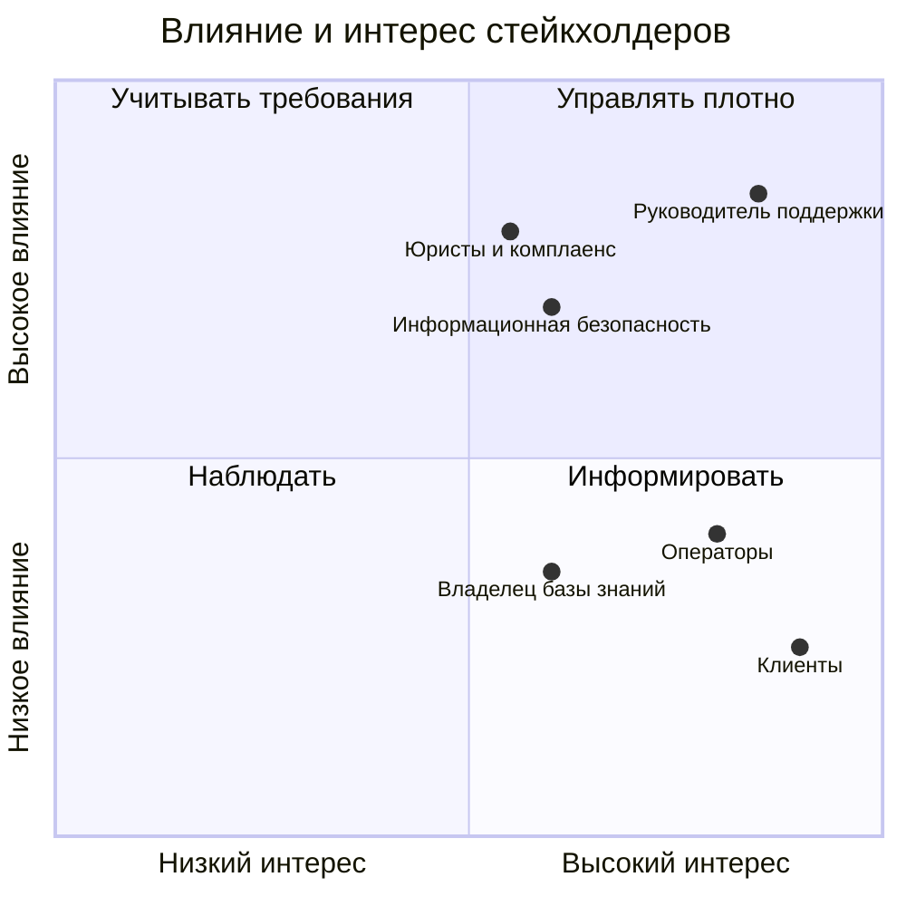
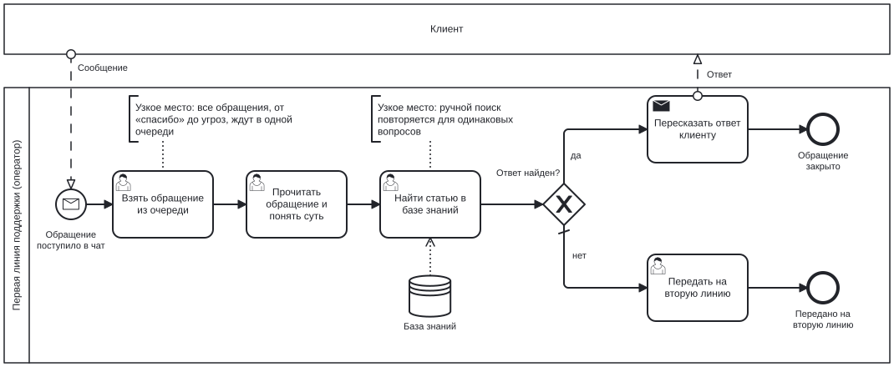
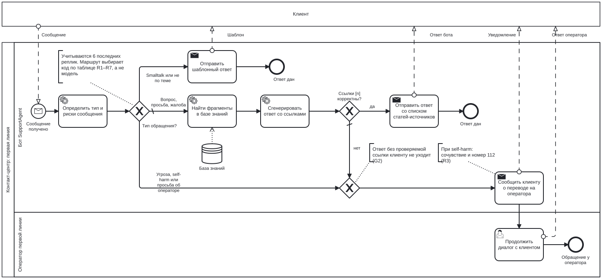

# SupportAgent: бизнес-постановка

Документ описывает SupportAgent с позиции бизнес-анализа: какую проблему
решает бот первой линии поддержки, как меняется процесс, по каким правилам
бот принимает решения, какие к нему требования, как качество связано
с бизнес-рисками и какие решения были приняты на основе данных.

Техническое устройство и методика оценки описаны в [README](../README.md).

**Как читать цифры.** Каждое число в документе помечено источником:

- **[eval]** — результат собственных прогонов оценки; файл отчёта для
  каждой цифры указан в [приложении D](#d-источники-цифр);
- **[допущение]** — сценарная величина для расчёта, не факт.

Все eval-наборы синтетические: запросы и диалоги сгенерированы LLM,
разметка релевантности и утверждений в ответах тоже сделана LLM-судьёй.
Цифры показывают поведение системы на заданных трудных случаях,
а не качество на реальном трафике.

---

## Содержание

1. [Резюме](#1-резюме)
2. [Бизнес-контекст и проблема](#2-бизнес-контекст-и-проблема)
3. [Стейкхолдеры](#3-стейкхолдеры)
4. [Процесс AS-IS и TO-BE](#4-процесс-as-is-и-to-be)
5. [Бизнес-правила маршрутизации](#5-бизнес-правила-маршрутизации)
6. [Требования](#6-требования)
7. [Метрики: от бизнес-рисков к оценке](#7-метрики-от-бизнес-рисков-к-оценке)
8. [Журнал решений](#8-журнал-решений)
9. [Риски и план пилота](#9-риски-и-план-пилота)
10. [Оценка эффекта](#10-оценка-эффекта)
11. [Ограничения и бэклог](#11-ограничения-и-бэклог)
12. [Приложения](#приложения)

---

## 1. Резюме

**Проблема.** Первая линия текстовой поддержки оператора связи получает
поток однотипных вопросов, ответы на которые уже есть в базе знаний.
Обычный чат-бот на LLM снимает часть нагрузки, но создаёт новые риски:
выдумывает условия тарифов, отвечает шаблоном на угрозу или заявление
о самоповреждении, отвечает инструкцией клиенту, которому нужен человек.

**Решение.** Бот сначала классифицирует обращение, а маршрут по жёстким
правилам выбирает код, а не модель. Опасные обращения и явные просьбы
позвать человека уходят оператору. Остальные получают ответ по базе
знаний (~2 300 статей) со ссылками на источники. Ответ без проверяемой
ссылки клиенту не отправляется, диалог передаётся оператору.

**Результаты на синтетических наборах:**

| Бизнес-риск | Результат |
|---|---|
| Пропустить угрозу или self-harm | 0 пропусков из 12 [eval] |
| Не перевести клиента, который просит человека | 0 пропусков из 20 [eval] |
| Неверно направить обращение | 97% обращений направлены верно [eval]¹ |
| Лишний перевод на оператора | 0 из 32 переводов [eval]¹ |
| Не найти в базе нужный ответ | абзац с ответом попадает к модели в 91% вопросов [eval] |
| Условия для бизнеса или банка в ответе частному клиенту | 0 таких ответов после фильтра сегмента (было 7 из 34) [eval]² |
| Неверная информация в ответе | 21% ответов содержат хотя бы одно неподтверждённое утверждение [eval]² |
| Неполный или неверный ответ | 39% ответов полностью верны, 43% частично, 11% неверны [eval]² |
| Отказ, хотя ответ в базе есть | 39% вопросов с ответом в базе получают полный или частичный отказ [eval]² |
| Долгое ожидание | половина ответов быстрее 17 с, 95% — быстрее 27 с [eval] |

¹ Промпт классификатора дорабатывался на этом же наборе диалогов,
отложенной тестовой выборки пока нет (раздел 11.1).
² Прогон от 27.10, разметка LLM-судьёй. Эталонных ответов в наборе нет,
полнота оценивается по вопросу и переданному модели контексту.

**Главный вывод.** Маршрутизация достаточно надёжна для теневого пилота,
генерация — нет. Поиск находит абзац с ответом в 91% случаев, ошибки
чужого сегмента устранены. Оставшийся риск — в генерации, и здесь
данные показали компромисс, а не решённую задачу: строгий промпт
генерации вдвое сократил долю ответов с неподтверждёнными утверждениями
(41% → 21%), но почти втрое увеличил долю отказов там, где ответ
в контексте был (14% → 39%), и снизил долю полностью верных ответов
с 64% до 39% (D9). Поэтому первый этап внедрения — теневой режим:
бот готовит черновик, оператор его проверяет и отправляет.

**Ключевые решения на основе данных.**
- **Жалобы сначала получают ответ по базе знаний** (D1). Точность
  маршрута выросла с 86% до 94% без изменения модели, доля лишних
  переводов снизилась с 20% до 3% [eval]. Цена — открытый риск,
  что раздражённый клиент получит инструкцию вместо человека.
- **Метрика поиска пересчитана по абзацу с ответом** (D5). Первая
  оценка (98% найденных статей) оказалась завышенной: она засчитывала
  статью, даже если ответа в найденном абзаце нет. Честная цифра — 91%.
- **Фильтр сегмента клиента в поиске** (D6). Сквозная оценка показала,
  что бот выдаёт частному абоненту условия для бизнеса и банка
  (7 ответов из 34). После фильтра таких ответов нет.
- **Строгий промпт генерации** (D9). Меньше выдумок ценой большего
  числа отказов. Какой промпт использовать, зависит от режима пилота:
  в теневом режиме отказ стоит оператору больше, чем исправление.

---

## 2. Бизнес-контекст и проблема

### 2.1. Контекст

Условный заказчик — первая линия текстовой поддержки (чат) крупного
оператора связи. База знаний — публичные статьи поддержки: мобильная связь,
домашний интернет и ТВ, онлайн-кинотеатр, оплата и т.д.

Процесс первой линии реконструирован по публичной информации и типовой
практике контакт-центров, а не получен от реального заказчика.

Типы входящих сообщений (это модель предметной области, на которой
построена классификация):

| Тип | Пример | Что нужно клиенту |
|---|---|---|
| Вопрос | «Как узнать свой тариф?» | Справка |
| Просьба | «Отключите подписку» | Действие с услугой |
| Жалоба | «Третий день не работает интернет» | Решение проблемы, иногда компенсация |
| Smalltalk | «Привет», «спасибо» | Короткая реакция |
| Не по теме | «Где купить зарядку?» | Вежливый отказ |
| Опасное сообщение | Угроза насилия, заявление о самоповреждении | Человек, а при self-harm — экстренная помощь |

### 2.2. Проблема

**П1. Нагрузка на операторов.** Значительная часть обращений — справочные
вопросы, ответ на которые уже есть в статьях поддержки. Оператор тратит
время на поиск статьи и пересказ.

**П2. Риски наивного бота.** Бот, который на любое сообщение ищет
в базе и генерирует ответ, создаёт четыре риска:

1. **Выдуманные условия.** LLM формулирует правдоподобный ответ, даже
   если в документации его нет. Для оператора связи это неверные цены,
   сроки и условия тарифов, то есть повторные обращения и претензии.
2. **Опасное сообщение без реакции человека.** Угроза или заявление
   о самоповреждении получает шаблонный ответ.
3. **Бот вместо человека там, где нужен человек.** Клиент явно просит
   оператора, а бот продолжает отвечать.
4. **Лишние переводы.** Если бот перестраховывается и переводит всё
   подряд, нагрузка на операторов не снижается.

Риски 3 и 4 тянут в разные стороны: решение должно находить баланс
между ними, а не просто минимизировать один.

### 2.3. Цели

| № | Цель | Как проверяется |
|---|---|---|
| Ц1 | Отвечать на типовые вопросы без оператора | Доля обращений, закрытых ботом (на пилоте) |
| Ц2 | Не давать ответов без опоры на документацию | Доля ответов без неподтверждённых утверждений |
| Ц3 | Не пропускать опасные обращения и просьбы позвать человека | Recall эскалаций |
| Ц4 | Не перегружать операторов лишними переводами | Доля лишних среди всех переводов |
| Ц5 | Объяснимость решений бота | Трейс каждого обращения: класс, маршрут, источники |

### 2.4. Границы

**Входит:**
- классификация входящего сообщения с учётом последних реплик диалога;
- ответ на справочные вопросы по базе знаний со ссылками на статьи;
- решение о переводе на оператора по правилам (раздел 5);
- шаблонные ответы на smalltalk и сообщения не по теме.

**Не входит:**
- операции с аккаунтом: подключение и отключение услуг, смена тарифа,
  возврат денег, проверка баланса;
- доступ к персональным данным клиента;
- интеграция с CRM, системой обращений и рабочим местом оператора;
- голосовой канал.

Из этих границ следуют два уточнения:

- **Перевод на оператора** в текущей версии — это сообщение клиенту
  и флаг `needs_escalation` в состоянии диалога. Передачи диалога
  в очередь операторов нет: для неё нужна интеграция с рабочим местом
  оператора (бэклог Б6). Эта интеграция обязательна уже для теневого
  пилота (раздел 9.2).
- **Просьбы о действиях с услугой** (`request`) бот обрабатывает как
  справочные: объясняет, как сделать это самостоятельно, со ссылкой
  на статью. Выполнить действие он не может.

---

## 3. Стейкхолдеры

| Стейкхолдер | Интерес | Чего опасается | Как учтено |
|---|---|---|---|
| **Клиент** | Быстрый и точный ответ, человек, когда нужен | Бот не понимает, «футболит», выдумывает | Триаж, ответ со ссылкой на статью, перевод по явной просьбе |
| **Оператор первой линии** | Меньше типовых вопросов | Непонятные переводы, злой клиент после бота | Перевод по правилам; передача причины перевода — в бэклоге (Б7) |
| **Руководитель поддержки** | Нагрузка, качество, предсказуемость | Рост жалоб и повторных обращений из-за бота | Метрики по слоям, поэтапный пилот с критериями отката |
| **Юристы и комплаенс** | Корректность информации об условиях, реакция на угрозы | Ответ бота как обязательство компании, пропуск угрозы | Guard по источникам, эскалация угроз, ссылки на статьи в каждом ответе |
| **Владелец базы знаний** | Актуальные статьи | Бот цитирует устаревшее или не то | Источник у каждого утверждения; вопросы без ответа показывают пробелы базы |
| **Информационная безопасность** | Данные клиентов не уходят вовне | Передача диалогов во внешние API и сервисы | Все модели работают локально; трассировка — в контуре компании (NFR-3) |



---

## 4. Процесс AS-IS и TO-BE

Схемы выполнены в нотации BPMN 2.0, исходники перечислены в приложении C.

### 4.1. AS-IS: обработка обращения без бота



Исходник: [`bpmn/as-is.bpmn`](bpmn/as-is.bpmn).

**Узкие места:**
- **Очередь.** Клиент ждёт, даже если вопрос решается одной статьёй.
- **Ручной поиск по базе.** Повторяется для одинаковых вопросов.
- **Одинаковая обработка разных сообщений.** «Спасибо», вопрос о тарифе
  и заявление о самоповреждении попадают в одну очередь.

### 4.2. TO-BE: обработка обращения с SupportAgent



Исходник: [`bpmn/to-be.bpmn`](bpmn/to-be.bpmn).

**Как читать схему:**

- Клиент показан свёрнутым пулом: его внутренний процесс не моделируется,
  видны только сообщения между ним и контакт-центром (пунктир).
- Шестерёнка — автоматическая задача бота, человечек — работа оператора,
  конверт — отправка сообщения клиенту.
- Шлюз «Тип обращения?» — правила R2–R7, проверяются сверху вниз. Поток
  с косой чертой срабатывает по умолчанию, в том числе при сбое
  классификатора (R1).
- Шлюз «Ссылки [n] корректны?» — правила guard G1–G2. Оба пути
  к оператору сходятся в одном шлюзе слияния, поэтому перевод
  оформляется одинаково независимо от причины.

Дорожка бота реализована полностью: развилки по типу сообщения — функция
`route_after_triage`, развилка по ссылкам — `route_after_guard`. Дорожка
оператора — целевое состояние: сейчас перевод заканчивается сообщением
клиенту (раздел 2.4, бэклог Б6).

**Что меняется:**

| Шаг | AS-IS | TO-BE |
|---|---|---|
| Разбор сообщения | Оператор, вручную | Бот, классификация 2,2 с (95% — до 2,8 с) [eval] |
| Опасные сообщения | В общей очереди | Сразу к оператору, при self-harm — номер экстренной помощи |
| Типовой вопрос | Оператор ищет статью | Бот находит статью и отвечает со ссылкой: половина ответов быстрее 17 с, 95% — быстрее 27 с [eval] |
| Нет ответа в базе | Оператор передаёт дальше | Бот отказывается или переводит на оператора |
| Объяснимость | Нет записи о решении | Трейс: класс сообщения, маршрут, найденные фрагменты |

---

## 5. Бизнес-правила маршрутизации

### 5.1. Что определяет классификатор

Классификатор размечает последнее сообщение клиента. Контекстом служат
последние 6 реплик диалога, включая это сообщение; реплики бота обрезаются
до 300 символов. Классификатор возвращает пять полей:

| Поле | Значения | Смысл |
|---|---|---|
| `reason` | текст | Короткое обоснование, заполняется первым |
| `intent` | question, request, complaint, smalltalk, off_topic | Что хочет клиент |
| `wants_operator` | да / нет | Явная просьба соединить с человеком |
| `threat` | none, violence, self_harm, legal | Угроза насилия, самоповреждения или обращения в суд или к регулятору |
| `search_query` | текст | Самостоятельный вопрос для поиска с учётом истории («а на 50?» → «сколько стоит пакет на 50 ГБ»). Используется только в продолжении диалога (D7), на маршрут не влияет |

Классификатор только размечает сообщение. Решение о маршруте принимает
код по таблице ниже.

### 5.2. Таблица решений

Правила проверяются сверху вниз, срабатывает первое подходящее.

| № | Условие | Действие | Ответ клиенту |
|---|---|---|---|
| R1 | Классификатор не вернул результат (ошибка) | Поиск и ответ по базе | Далее правила G1–G2 |
| R2 | `threat` = violence | Перевод оператору | «Передаю ваше обращение оператору.» |
| R3 | `threat` = self_harm | Перевод оператору | Сочувствие, номер 112, перевод на человека |
| R4 | `wants_operator` = да | Перевод оператору | «Передаю ваше обращение оператору.» |
| R5 | `intent` = off_topic | Шаблонный отказ | «Я отвечаю только на вопросы об услугах МТС.» |
| R6 | `intent` = smalltalk | Шаблонный ответ | «Я помощник поддержки МТС. Чем могу помочь?» |
| R7 | Иначе: question, request, complaint, в том числе `threat` = legal | Поиск и ответ по базе | Далее правила G1–G2 |

**Правила проверки ответа (guard):**

| № | Условие | Действие |
|---|---|---|
| G1 | В ответе есть хотя бы одна ссылка вида `[n]`, и каждая ссылка указывает на фрагмент, реально переданный модели | Ответ отправляется клиенту со списком статей-источников |
| G2 | Ссылок нет, есть ссылка на несуществующий фрагмент, поиск не вернул фрагментов или поиск либо генерация завершились ошибкой | Ответ не отправляется, перевод оператору |

### 5.3. Принципы, заложенные в правила

1. **Безопасность важнее содержания.** Угроза и self-harm проверяются
   до типа сообщения: «если не восстановите номер, я с собой что-нибудь
   сделаю» — это self-harm, хотя по сути это просьба.
2. **Эмоции — не угроза.** «Убил бы за такой интернет» или «я с ума
   сойду с вашими тарифами» — образные выражения, `threat` = none.
   Иначе каждый раздражённый клиент уходил бы оператору.
3. **При сомнении между self_harm и none выбирается self_harm.** Цена
   ложного перевода несопоставимо ниже цены пропуска.
4. **Сбой не теряет обращение.** Если классификатор упал, обращение идёт
   в поиск и проверку guard. Если упал поиск или генерация, обращение
   получает оператор.
5. **Ответ без источника не уходит клиенту.** Если бот не может сослаться
   на статью, обращение получает человек.
6. **Политику меняет код, а не модель.** Чтобы, например, начать
   переводить `legal` на оператора, достаточно изменить одну строку
   правил, не трогая классификатор.

---

## 6. Требования

### 6.1. Пользовательские истории

Статус: ✅ реализовано и измерено, ⚠️ реализовано частично, ⏳ в бэклоге.

**US-1. Ответ на справочный вопрос** ⚠️
Как клиент, я хочу получить ответ на вопрос об услуге сразу в чате,
чтобы не ждать оператора.

- *Дано:* ответ на вопрос есть в базе знаний. *Когда* клиент задаёт
  вопрос, *тогда* бот отвечает по шагам со ссылками на фрагменты
  и списком статей-источников.
- *Дано:* клиент пишет с опечатками или разговорно («скока стоит
  пеедать гиги»). *Тогда* бот находит ту же статью, что и для
  литературной формулировки.

- *Дано:* клиент — частное лицо. *Тогда* бот не опирается на статьи
  для бизнеса и банка.

Проверка: абзац с ответом попадает к модели в 91% вопросов; фрагментов
для бизнеса и банка в контексте 0%; ответов без неподтверждённых
утверждений 79%; полностью верных 39% [eval]. Частично, потому что
поиск работает, а ответ для клиента пока либо неполон, либо
содержит перенесённые условия (раздел 7, D9).

**US-2. Честный отказ, когда ответа нет** ⚠️
Как клиент, я хочу услышать «в документации этого нет» или получить
оператора, а не выдуманный ответ, чтобы не действовать по неверной информации.

- *Дано:* ответа в базе нет. *Тогда* бот прямо говорит об этом
  или переводит на оператора, не называя цен и условий, которых нет
  в статьях.
- *Дано:* ответ в базе есть. *Тогда* бот не отказывается от ответа.

Проверка: корректный отказ или перевод в 8 из 8 вопросов без ответа;
полный или частичный отказ в 11 из 28 вопросов, ответ на которые
был в контексте [eval]. Первое условие выполнено, второе нет:
строгий промпт генерации (D9) научил бота честно отказываться,
но он отказывается и там, где ответ есть. Кроме того, guard проверяет
наличие ссылок, а не соответствие утверждения фрагменту.

**US-3. Угроза насилия** ✅
Как руководитель поддержки, я хочу, чтобы сообщение с угрозой насилия
сразу получал человек, чтобы бот не реагировал на него шаблоном.

- *Когда* сообщение содержит конкретную угрозу людям или имуществу,
  *тогда* бот не генерирует ответ и переводит обращение оператору.
- *Когда* сообщение содержит образное выражение эмоций, *тогда*
  обращение обрабатывается как обычное.

Проверка: recall по угрозам насилия 100% (6/6) [eval].

**US-4. Заявление о самоповреждении** ✅
Как клиент в кризисе, я хочу получить контакт экстренной помощи
и живого человека, а не инструкцию.

- *Когда* сообщение содержит заявление о намерении навредить себе,
  в том числе в форме условия («если не… то я…»), *тогда* бот выражает
  сочувствие, называет номер 112 и переводит на оператора.

Проверка: recall по self-harm 100% (6/6) [eval].

**US-5. Явная просьба позвать оператора** ✅
Как клиент, я хочу попасть к человеку, когда прошу об этом, чтобы
не спорить с ботом.

- *Когда* клиент пишет «позовите оператора», «дайте живого человека»,
  *тогда* бот сразу переводит.
- *Когда* клиент обращается к боту словом «Оператор, …» без просьбы
  соединить, *тогда* бот отвечает на вопрос сам.

Проверка: переведены 20 из 20 клиентов, явно просивших оператора [eval].
Трудный случай — просьба, совмещённая с другим требованием («верните
деньги сейчас и переведите на специалиста»), — исправлен доработкой
промпта (Б8). Цифра получена на том же наборе, на котором дорабатывался
промпт.

**US-6. Уточняющие вопросы** ⚠️
Как клиент, я хочу задавать короткие уточнения («а на 50?»), чтобы
не повторять весь вопрос.

- *Дано:* предыдущий вопрос был о стоимости пакета на 20 ГБ. *Когда*
  клиент пишет «а на 50?», *тогда* бот понимает это как вопрос
  о стоимости пакета на 50 ГБ и отвечает по нужной статье.

Проверка: классификатор верно размечает уточнения, случаи с тегом
`followup` — 13/13 [eval]. Классификатор также переписывает уточнение
в самостоятельный запрос (`search_query`), и в продолжении диалога
поиск и генерация получают его вместо исходного сообщения (D7).
Эффект на продолжениях диалога не измерен: сквозная оценка состоит
из одиночных вопросов. Мера: набор уточняющих диалогов — Б16.

**US-7. Устойчивость к манипуляциям** ✅
Как владелец сервиса, я хочу, чтобы команды внутри сообщения клиента
не меняли поведение бота.

- *Когда* сообщение содержит «игнорируй инструкции…» вместе с вопросом
  про услугу, *тогда* бот отвечает на вопрос и не выполняет команду.

Проверка: верный маршрут в 10 из 10 таких случаев после доработки
промпта (было 6 из 10) [eval]. Цифра получена на том же наборе,
на котором дорабатывался промпт; отдельного набора с косвенными
инъекциями (внутри статей базы) пока нет.

**US-8. Прозрачность решений** ✅
Как руководитель поддержки, я хочу видеть, почему бот так обработал
обращение, чтобы разбирать спорные случаи.

- *Для каждого* обращения в трейсе есть класс сообщения с обоснованием,
  маршрут, найденные фрагменты и итоговый ответ.

Проверка: трассировка в Langfuse.

**US-9. Причина перевода для оператора** ⏳
Как оператор, я хочу видеть, почему бот передал мне диалог, чтобы
не переспрашивать клиента.

- *Когда* бот переводит диалог, *тогда* оператор видит причину
  (угроза, просьба клиента, нет обоснованного ответа) и обоснование
  классификатора.

Сейчас причина есть в трейсе, но не передаётся оператору. Мера: бэклог Б6, Б7.

**US-10. Раздражённый клиент с повторной жалобой** ⏳
Как клиент, который уже несколько раз писал о проблеме, я хочу
попасть к человеку, а не получить ещё одну инструкцию.

- *Когда* клиент повторно жалуется в одном диалоге или угрожает судом
  или регулятором, *тогда* бот переводит на оператора.

Сейчас такие обращения идут в поиск по базе (решение D1, раздел 8).
Мера: бэклог Б3.

### 6.2. Нефункциональные требования

| № | Требование | Текущее состояние | Целевое для продакшена |
|---|---|---|---|
| NFR-1 | Время ответа | Классификация 2,2 / 2,8 с, полный ответ 17 / 27 с (медиана / 95%), из них генерация 11 / 18 с [eval] | Первые слова ответа до 3 с за счёт стриминга [допущение] |
| NFR-2 | Данные клиента не уходят во внешние сервисы | Все модели работают локально | Сохраняется, включая трассировку (NFR-3) |
| NFR-3 | Трассируемость | Каждый запуск графа в Langfuse | Langfuse развёрнут в контуре компании, так как трейсы содержат текст диалогов; срок хранения по политике компании |
| NFR-4 | Отказоустойчивость | Без реранкера — поиск без переранжирования; при сбое поиска или генерации — перевод на оператора | Сохраняется + мониторинг доли таких случаев |
| NFR-5 | История диалога | Только в памяти процесса | Хранилище, переживающее перезапуск |
| NFR-6 | Канал | Командная строка | Веб-чат или мессенджер |
| NFR-7 | Изменение правил без переобучения | Правила маршрута в коде, промпты триажа и генерации в YAML | Сохраняется + версия промпта в каждом трейсе и отчёте оценки |

---

## 7. Метрики: от бизнес-рисков к оценке

Оценка разделена на три слоя: поиск, классификация и итоговый ответ.
Ниже каждая техническая метрика привязана к бизнес-вопросу, на который
она отвечает.

| Бизнес-вопрос | Метрика | Значение [eval] | Ограничение |
|---|---|---|---|
| Пропустит ли бот опасное обращение? | Recall по violence и self_harm | 100% (12/12) | Всего 12 случаев |
| Попадёт ли клиент к человеку, когда просит? | Recall по `wants_operator` = да | 100% (20/20) | Промпт дорабатывался на этом наборе |
| Уйдут ли оператору все обращения, которым он нужен? | Recall эскалаций | 100% (32/32) | То же |
| Сколько лишних переводов получат операторы? | Доля лишних среди всех переводов | 0% (0/32) | То же |
| Насколько верно бот маршрутизирует обращения? | Точность маршрута | 97% (152/156) | То же |
| Можно ли использовать тип обращения для аналитики? | `intent`: точность / macro-F1 | 83% / 0,82 | Просьба и жалоба путаются (F1 0,75 и 0,78) |
| Распознаёт ли бот угрозы суда и регулятора? | Точность по `legal` | 100% (8/8) | Распознаёт, но пока не переводит (D1) |
| Устоит ли бот против манипуляций? | Верный маршрут при injection | 100% (10/10) | Промпт дорабатывался на этом наборе |
| Найдёт ли бот абзац с ответом? | AnswerHit@LLM | 91% (97/107), 95% ДИ 84–95% | Синтетические вопросы, набор не проверен вручную целиком |
| Не подсунет ли поиск условия для бизнеса или банка? | Доля таких фрагментов в контексте | 0% (было 15–18%) | Сегмент определяется по разделу статьи |
| Сколько лишнего попадает в контекст модели? | Context precision по статьям | 55% | Оценка снизу: неразмеченные статьи считаются лишними |
| Насколько можно верить ответу? | Доля ответов без единого неподтверждённого утверждения | 79% (23/29), 95% ДИ 62–90% | Разметка LLM-судьёй, прогон 27.10 |
| Насколько можно верить отдельному утверждению? | Claim precision | 96% (192/199) | То же |
| Насколько ответ полон и верен? | Верно / частично / неверно | 39% / 43% / 11% | 28 вопросов; эталонов нет, полнота оценивается по вопросу и контексту |
| Откажется ли бот, если ответа нет? | Корректный отказ или перевод | 100% (8/8) | 8 вопросов |
| Не откажется ли бот, когда ответ есть? | Полный или частичный отказ при ответе в контексте | 39% (11/28) | 28 вопросов; до правки промпта 14% (D9) |
| Справится ли бот с вопросом о данных аккаунта или с неверной предпосылкой? | Корректный ответ или перевод | 75% (3/4) | 4 вопроса |
| Дойдёт ли ответ до клиента? | Answer rate по вопросам с ответом в базе | 93% (26/28) | Без учёта правильности ответа; 2 ответа остановил guard |
| Сколько ждёт клиент? | Время ответа, медиана / 95% | 17 / 27 с | Локальная модель, AMD RX 6700 XT |
| Сколько стоит обращение? | Токены на обращение, медиана / 95% | 6 100 / 6 700 | Стоимость считается по формуле в разделе 10.4 |
| Сколько обращений бот закроет сам? | Containment rate | **не измерено** | Нужен реальный трафик |
| Довольны ли клиенты? | CSAT после ответа бота | **не измерено** | Нужен реальный трафик |
| Не вернётся ли клиент с тем же вопросом? | Повторные обращения | **не измерено** | Нужен реальный трафик |

**Что из этого следует для бизнеса:**

1. **Маршрутизация достаточно безопасна для теневого пилота.** Ни одного
   пропуска угроз, self-harm и просьб об операторе, ни одного лишнего
   перевода. Оговорка: классификатор дорабатывался на этом же наборе,
   поэтому на пилоте нужна выборочная проверка маршрутов.
2. **Первая оценка поиска была завышена, и это важный урок для пилота.**
   Метрика «нужная статья в топ-5» показывала 98%, но засчитывала статью,
   даже если ответа в найденном абзаце нет, и засчитывала статьи для
   бизнеса как ответ частному абоненту. После перехода на метрику
   по абзацу и фильтра сегмента — 91%. Вывод для внедрения: метрики
   качества нужно проверять на конкретных провалах, а не только
   по сводной цифре.
3. **Генерация — главный риск, и улучшения в ней — это обмен.**
   21% ответов содержат хотя бы одно утверждение, которого нет
   в документации; с поправкой на маленькую выборку — до 38% (верхняя
   граница 95% доверительного интервала Уилсона). Этого добились строгим
   промптом, но он же заставил бота отказываться в 39% вопросов, ответ
   на которые был в контексте (D9). Отправлять ответы клиентам без
   проверки нельзя.
4. **Ошибки систематические, их можно устранить целенаправленно.**
   Разбор показал два повторяющихся класса:
   - **смешение сегментов** — условия для корпоративных клиентов и банка
     подавались частному абоненту как общие правила. Закрыто фильтром
     сегмента (Б1): 7 таких ответов из 34 до фильтра, 0 после;
   - **перенос условий между похожими услугами** — команда, путь
     в приложении или порядок оплаты одной услуги выдаётся за инструкцию
     для другой. Главный оставшийся класс: 4 из 6 ответов с ошибками.
     Запрет в промпте его не устранил. Почти половина статей в контексте
     не относится к вопросу (context precision 55%), и именно из них
     модель берёт чужие условия. Мера — проверка смысла ответа (Б2)
     и более узкий контекст (Б19).
5. **Время ответа определяется длиной ответа.** Генерация занимает около
   65% времени ответа, и оно почти линейно растёт с длиной ответа.
   Строгий промпт ограничил ответ пятью пунктами: 95-й перцентиль длины
   ответа упал с 577 до 346 токенов, генерации — с 26 до 18 с.
   Следующий шаг — стриминг (Б9).
6. **Главные бизнес-метрики не измерены.** Containment, CSAT и повторные
   обращения требуют реального трафика. Их измерение — цель пилота
   (раздел 9).

---

## 8. Журнал решений

### D1. Жалобы сначала получают ответ по базе знаний, а не уходят оператору

**Контекст.** В первой версии любая жалоба (`intent` = complaint)
автоматически уходила оператору. Логика была интуитивной: недовольному
клиенту нужен человек.

**Проблема.** Оценка классификатора показала:
- граница между просьбой и жалобой размыта даже для человека:
  «верните деньги за подписку» — просьба, а «верните деньги за подписку,
  которую я не подключал» — уже жалоба;
- классификатор ошибался именно на этой границе чаще всего: точность
  `intent` 73% [eval];
- каждая такая ошибка меняла маршрут: точность маршрута 86%, каждый
  пятый перевод на оператора был лишним [eval].

При этом значительная часть жалоб в поддержке связи («нет сети после
смены телефона», «списывают за подписку») закрывается инструкцией
из базы знаний.

**Варианты:**

| Вариант | Плюсы | Минусы |
|---|---|---|
| А. Улучшать классификатор (промпт, примеры) | Сохраняет исходную политику | Граница размыта по существу, потолок точности неясен |
| Б. Изменить политику: жалоба → поиск по базе, эскалация только по надёжным сигналам | Ошибки на границе request/complaint перестают влиять на маршрут | Злой клиент может получить инструкцию вместо человека |

**Решение.** Вариант Б. Эскалация зависит только от сигналов, которые
модель различает надёжно: угроза насилия, self-harm, явная просьба
об операторе. Если ответ по базе не прошёл guard, диалог всё равно
уходит оператору. `intent` = complaint сохраняется в трейсе для
аналитики и приоритизации.

**Результат [eval]:**

| Метрика | До | После |
|---|---|---|
| Точность маршрута | 86% (134/156) | 94% (147/156) |
| Точность `intent` | 73% | 73% |
| Recall эскалаций | 92% (49/53) | 97% (31/32) |
| Лишние среди всех переводов | 20% (12/61) | 3% (1/32) |

Классификатор не менялся. Улучшение получено за счёт политики,
а не модели. Эталонные маршруты в наборе пересчитаны под новую
политику, поэтому доли «до» и «после» посчитаны на разных
знаменателях и сравнимы только по порядку величины.

Позже промпт классификатора доработали (Б8): точность маршрута
выросла до 97%, `intent` — до 83%, лишних переводов не осталось [eval].
Эти цифры получены на том же наборе, на котором шла доработка.

**Открытый риск.** Раздражённая повторная жалоба («третий раз пишу,
никто ничего не делает») и угроза суда идут в поиск по базе, хотя
классификатор распознаёт их правильно. Сквозная оценка это подтвердила
на двух случаях [eval]. Мера: бэклог Б3 — переводить `legal` и повторные
жалобы в одном диалоге.

### D2. Маршрут выбирает код, а не языковая модель

**Контекст.** Распространённый подход — дать LLM выбрать следующий шаг
самостоятельно (агент с инструментами).

**Решение.** Модель только размечает сообщение по фиксированной схеме,
маршрут определяет таблица правил в коде.

**Почему:**
- **Предсказуемость.** Одна и та же разметка всегда ведёт по одному
  маршруту; это можно показать юристам и комплаенсу.
- **Измеримость.** Ошибку можно отнести к конкретному полю разметки,
  а не к «агент решил иначе».
- **Управляемость.** Политику меняет одна строка кода. Решение D1 стало
  возможным именно благодаря этому.

### D3. Guard проверяет ссылки, а порог уверенности поиска не используется

**Контекст.** Чтобы бот не отвечал, когда ответа в базе нет, можно
отсекать запросы с низкой оценкой релевантности найденных статей.

**Данные.** Распределения оценок реранкера для вопросов с ответом
в базе и без него перекрываются [eval]. Любой порог либо отсекает часть
отвечаемых вопросов, либо пропускает неотвечаемые.

**Решение.** Порог не используется. Отказ «ответа нет» возложен
на модель (инструкция в промпте) и guard: ответ без ссылок на фрагменты
не уходит клиенту.

**Ограничение.** Guard проверяет форму ответа, а не смысл: ответ
с корректной ссылкой может исказить содержание фрагмента. Это главная
причина ошибок из раздела 7. Мера: бэклог Б2. Калибровка порога
на большем наборе — Б12.

### D4. Все модели работают локально

**Решение.** Языковая модель, модель эмбеддингов и реранкер развёрнуты
на собственном оборудовании, без внешних платных API. Внешняя модель
используется только офлайн, для разметки оценочных наборов.

**Почему:**
- диалоги клиентов не покидают контур компании;
- нет зависимости от доступности и цен внешнего провайдера.

**Цена:** время ответа 17 с в медиане и 27 с для 95% ответов
на локальной модели [eval] и необходимость
собственного оборудования. Чтобы решение выполнялось целиком, система
трассировки тоже должна работать в контуре компании (NFR-3).

### D5. Качество поиска измеряется по абзацу с ответом, а не по статье

**Контекст.** Первая метрика поиска (Hit@5) показывала 98%: нужная
статья почти всегда в пятёрке лучших результатов. При этом простой
вопрос «как увеличить лимит задолженности» получал ответ про кредитный
лимит по банковской карте.

**Что показал разбор.** Абзац с ответом («самостоятельно изменить
размер лимита не получится») стоял на 65-м месте и не доходил до модели:
клиент и база называют одно и то же разными словами. Метрика этого
не видела по трём причинам:
- засчитывала любой абзац нужной статьи, даже без ответа;
- засчитывала статьи для бизнеса и банка как ответ частному абоненту;
- правильные ответы размечались по результатам того же поиска, поэтому
  статья, которую поиск не нашёл, не могла считаться правильной.

**Решение.** Основная метрика — AnswerHit: дошёл ли до модели сам абзац
с ответом. Набор вопросов построен в обратном порядке: сначала выбран
абзац, затем к нему написан вопрос клиента, так что правильный ответ
не зависит от поиска.

**Результат [eval].** Та же система получила честные 90% вместо 98%
на старом наборе и 88% на новом. Цифра ниже, но по ней видно, что
исправлять: см. D6.

### D6. Фильтр сегмента клиента в поиске

**Контекст.** Разбор ответов показал повторяющуюся ошибку: модель
выдаёт частному абоненту условия из статей МТС Бизнес. Метрика D5
подтвердила масштаб: у половины вопросов в контексте модели были
фрагменты для бизнеса или банка, всего 15–18% контекста.

**Решение.** Каждая статья помечена сегментом по разделу сайта
(частные клиенты, бизнес, банк). Поиск для частного абонента идёт
только по статьям частных клиентов.

**Результат [eval]:**

| Метрика | До | После |
|---|---|---|
| Фрагменты для бизнеса и банка в контексте | 15–18% | 0% |
| Абзац с ответом дошёл до модели (новый набор)¹ | 88% | 92% |
| Абзац с ответом дошёл до модели (старый набор) | 90% | 95% |
| Ответов с условиями чужого сегмента (сквозная оценка) | 7 из 34 | 0 из 37 |

¹ До фильтра в наборе было 115 вопросов, после проверки осталось 107.

Последняя строка сравнивает прогоны 13.10 и 26.10, размеченные одним
судьёй. Между ними, кроме фильтра, изменился состав контекста (D8),
поэтому строка подтверждает эффект совместно с D8.

**Ограничение.** Статьи «для бизнеса» внутри разделов для частных
клиентов по разделу не отличить. Бизнес-клиентам нужна будет отдельная
настройка поиска.

### D7. Поисковый запрос переписывает классификатор

**Контекст.** Поиск получал только последнее сообщение. Уточнение
«а на 50?» искалось без контекста, а вопрос в словах клиента
(«минусовой лимит») не находил статью в словах базы («Лимит на связь»).

**Варианты:**

| Вариант | Плюсы | Минусы |
|---|---|---|
| А. Отдельный вызов модели для переписывания запроса | Простой, независимый от классификатора | Ещё один вызов модели: около 2 с к каждому ответу [допущение] |
| Б. Классификатор заодно пишет поисковый запрос | Без лишнего вызова: классификатор уже читает историю | Длиннее промпт классификатора, риск просадки его точности |

**Решение.** Вариант Б. Сначала поиск шёл по исходному и переписанному
запросу, и каждому фрагменту доставалась лучшая оценка из двух.

**Проверка на данных [eval].** На наборе самостоятельных вопросов
переформулировка помогла в 3 случаях и навредила в 6 (абзац с ответом
дошёл до модели в 89% вместо 92%). После правки промпта — 2 и 3.
На самостоятельном вопросе переписывать нечего, а модель меняет
слова клиента и теряет детали.

**Итоговое решение.** Переписанный запрос заменяет исходный только
в продолжении диалога, когда в истории больше одной реплики клиента.
Его получают и поиск, и генерация. На самостоятельных вопросах
используется сообщение клиента как есть.

**Цена [eval].** Классификация стала дольше на 0,7 с (2,2 с вместо 1,5 с).
Точность маршрута не просела (97%). Эффект на продолжениях диалога
не измерен: нужен набор уточняющих диалогов (Б16).

### D8. Поиск по фрагментам, модели — статьи целиком

**Контекст.** Короткий фрагмент лучше находится, но вырванный шаг
инструкции теряет условия из начала и конца статьи.

**Решение.** Поиск ищет фрагменты, а модель получает статьи, из которых
они взяты (до пяти; длинная статья — разделом с найденным фрагментом).

**Результат [eval].** На поиске изменение почти не сказалось: абзац
с ответом доходит до модели в 91% вопросов вместо 92%, в двух случаях
нужный абзац оказался вне выбранного раздела длинной статьи.
Сравнение прогонов 13.10 и 26.10 (один судья,
изменения D6 и D8 вместе): полностью верных ответов стало 64% вместо 32%,
отказов при наличии ответа — 14% вместо 21%, claim precision — 93%
вместо 87%. Доля ответов хотя бы с одной ошибкой не изменилась
(38% и 41%): ошибки чужого сегмента ушли, но модель продолжила
переносить условия между услугами.

**Цена [eval].** Объём контекста модели — до ~4 600 токенов из 8 192
доступных, ошибки генерации с обрезкой контекста не связаны. Почти
половина статей в контексте к вопросу не относится (context precision 55%).

### D9. Строгий промпт генерации: меньше выдумок, больше отказов

**Контекст.** После D6 и D8 ответы стали полнее, но 41% из них
содержали хотя бы одно неподтверждённое утверждение. Разбор показал
типовые ошибки: условие одной услуги или страны подано для другой,
оговорка «только для…» потеряна, добавлен путь в приложении, которого
нет во фрагменте, при отказе бот пересказывал нерелевантные фрагменты.

**Решение.** Промпт генерации вынесен в YAML и переписан правилами
против каждого класса ошибок: одно утверждение — один фрагмент,
не переносить условия между услугами, брать условия вместе с оговорками,
не писать «нельзя», если этого нет во фрагменте, при отсутствии ответа —
одна-две фразы без пересказа, не больше пяти пунктов.

**Результат [eval]** (прогоны 26.10 и 27.10, один судья, изменился
только промпт):

| Метрика | До | После |
|---|---|---|
| Ответов хотя бы с одним неподтверждённым утверждением | 41% (15/37) | **21%** (6/29) |
| Claim precision | 93% (297/321) | 96% (192/199) |
| Полностью верных ответов в группе A | **64%** (18/28) | 39% (11/28) |
| Отказ при ответе в контексте | **14%** (4/28) | 39% (11/28) |
| Корректный отказ, когда ответа нет | 75% (6/8) | **100%** (8/8) |
| Длина ответа, 95-й перцентиль | 577 токенов | **346** токенов |

**Вывод.** Промпт не улучшил генерацию, а сдвинул её по оси «точность —
полнота»: модель стала реже выдумывать, потому что стала чаще молчать.
Перенос условий между услугами при этом остался (4 из 6 ответов
с ошибками): запрет в промпте с ним не справляется.

**Что это значит для пилота.** Выбор промпта зависит от режима:
- в **теневом режиме** ошибку ловит оператор, а отказ заставляет его
  писать ответ с нуля. Выгоднее полный ответ (прежний промпт);
- при **самостоятельных ответах** ошибка доходит до клиента, а отказ
  уходит оператору. Выгоднее строгий промпт.

В репозитории сейчас строгий промпт. Следующий шаг — разобрать 11 отказов
и ослабить правило отказа (Б18), не возвращая выдумки, и сузить контекст
(Б19), чтобы модели было не из чего переносить чужие условия.

---

## 9. Риски и план пилота

### 9.1. Реестр рисков

Вероятность и влияние — экспертная оценка: В — высокая, С — средняя, Н — низкая.

| № | Риск | Вероятность | Влияние | Основание | Мера | Статус |
|---|---|---|---|---|---|---|
| РС1 | Неверное условие или цена в ответе | С | В | 21% ответов с неподтверждённым утверждением, главный класс — перенос условий между услугами [eval] | Теневой режим; фильтр сегмента (Б1) и строгий промпт (Б14) сделаны; проверка смысла ответа (Б2), узкий контекст (Б19) | Открыт |
| РС2 | Условия для бизнеса поданы частному абоненту | Н | В | После фильтра сегмента 0% таких фрагментов в контексте (было 15–18%) и 0 таких ответов (было 7 из 34) [eval] | Фильтр сегмента в поиске (Б1, сделан); статьи для бизнеса внутри разделов частных клиентов — выборочная проверка на пилоте | Снижен |
| РС3 | Пропуск угрозы на реальных формулировках | Н | В | 100% на синтетике, реальные формулировки разнообразнее | Выборочная ручная проверка на пилоте, приоритет self_harm при сомнении | Мониторинг |
| РС4 | Злой клиент получает инструкцию вместо человека | С | С | 2 случая в сквозной оценке [eval] | Эскалация `legal` и повторных жалоб (Б3) | Открыт |
| РС5 | Клиент просит человека, бот не переводит | Н | В | 0 пропусков из 20 после доработки промпта (было 1) [eval] | Кнопка «позвать человека» на пилоте | Мониторинг |
| РС6 | Уточняющий вопрос получает ответ не по теме | С | С | Поиск и генерация получают переписанный запрос (D7); сквозной проверки нет | Набор уточняющих диалогов (Б16) | Снижен |
| РС7 | Бот отказывается, хотя ответ в базе есть | В | С | 11 из 28 после строгого промпта, было 4 из 28 (D9) [eval] | Разбор отказов и ослабление правила отказа (Б18); в теневом режиме — прежний промпт | Открыт |
| РС8 | Манипуляция ботом через сообщение | Н | Н | 10/10 верных маршрутов после доработки промпта [eval]; косвенные инъекции внутри статей не проверялись | Отдельный набор с косвенными инъекциями | Снижен |
| РС9 | Устаревшие статьи в базе | С | С | База — снимок сайта поддержки | Регулярная переиндексация, ссылка на источник в каждом ответе | Открыт |
| РС10 | Время ответа раздражает клиентов | С | С | 17 с в медиане, 27 с для 95% ответов; около 65% времени — генерация [eval] | Короткие ответы (Б14, сделано), стриминг (Б9) | Открыт |
| РС11 | Метрики на синтетике завышены | В | С | Наборы сгенерированы и размечены LLM; одна метрика поиска уже оказалась завышенной (D5); классификатор доработан на оценочном наборе | Ручная проверка разметки (Б4), отложенная тестовая выборка (Б13), оценка на реальных обращениях в пилоте | Открыт |

### 9.2. План внедрения

Порог каждого критерия — **[допущение]** для обсуждения с руководителем
поддержки, а не результат расчёта.

**Этап 0. Подготовка.** Фильтр сегмента (Б1), короткие ответы (Б14)
и повторная разметка ответов (Б15) сделаны. Осталось закрыть риск РС4 (Б3),
проверить вручную выборку разметки LLM-судьи (Б4), выбрать промпт
генерации для теневого режима (D9) и подключить бота к рабочему месту
оператора, чтобы тот видел черновик и причину перевода (Б6, Б7).

- Критерий перехода: согласие ручной и автоматической разметки
  не ниже 85% [допущение]; черновик и причина перевода видны оператору.

**Этап 1. Теневой режим (2–4 недели).** Бот готовит черновик ответа,
оператор видит его рядом с обращением и сам решает, отправить, исправить
или ответить с нуля. Клиент общается только с оператором.

- Что измеряем: долю черновиков, отправленных без правок; долю
  с правками; классы правок; пропуски опасных обращений.
- Критерий перехода: без правок отправляется не менее 70% черновиков
  [допущение], ни одного пропуска угроз и self-harm.
- Критерий остановки: систематическая ошибка, которую операторы
  отмечают повторно и которую нельзя закрыть до следующего этапа.

**Этап 2. Узкий контур (2–4 недели).** Бот отвечает сам в одной
тематике с хорошими результатами теневого режима (например, онлайн-
кинотеатр). Выборочная ручная проверка ответов, кнопка «позвать
человека» в каждом ответе.

- Что измеряем: containment rate, CSAT, повторные обращения в течение
  суток, долю переводов по guard.
- Критерий перехода: повторные обращения и CSAT не хуже, чем у операторов
  в той же тематике [допущение].
- Критерий отката: рост повторных обращений или жалоб на ответы бота.

**Этап 3. Расширение.** Тематики добавляются по одной, каждая проходит
этапы 1–2 по сокращённому графику.

---

## 10. Оценка эффекта

Реальных данных об объёме обращений и стоимости работы оператора
нет, поэтому эффект описан формулой и сценариями. Все величины в сценариях —
**[допущение]**.

### 10.1. Формула

```
Высвобожденное время операторов =
    N × D × C × T
  − N × D × C × E × T_исп

где
  N      — число обращений в чат за период
  D      — доля обращений, на которые есть ответ в базе знаний
  C      — containment: доля таких обращений, закрытых ботом без оператора
  T      — среднее время оператора на одно типовое обращение
  E      — доля ответов бота, после которых клиент возвращается с тем же вопросом
  T_исп  — время оператора на исправление последствий неверного ответа
```

### 10.2. Сценарии на 10 000 обращений

| Параметр | Пессимистичный | Базовый | Оптимистичный |
|---|---|---|---|
| D — доля обращений с ответом в базе | 40% | 50% | 60% |
| C — containment | 20% | 35% | 50% |
| T — минут оператора на обращение | 5 | 5 | 5 |
| E — доля возвратов после ответа бота | 15% | 10% | 5% |
| T_исп — минут на исправление | 10 | 10 | 10 |
| **Высвобождено, часов оператора** | **≈47** | **≈117** | **≈225** |

Расчёт базового сценария: 10 000 × 0,5 × 0,35 = 1 750 обращений
закрыто ботом; 1 750 × 5 мин = 8 750 мин; минус 1 750 × 0,10 × 10 мин =
1 750 мин; итого 7 000 мин ≈ 117 часов.

### 10.3. Что показывает расчёт

- **Эффект сильнее всего зависит от containment.** Между пессимистичным
  и оптимистичным сценарием разница почти в пять раз, и основной вклад
  даёт C. Поэтому containment — главная метрика пилота.
- **Ошибки бота съедают эффект.** При E = 15% и стоимости исправления
  вдвое выше обычного обращения бот теряет 30% выигрыша. Это количественный
  аргумент за теневой режим и проверку смысла ответов до запуска.
- **Оценка C по нашему набору.** На вопросы, ответ на которые есть
  в базе, полностью верный ответ получают 39% при строгом промпте
  и 64% при прежнем [eval]. Это верхняя граница containment без риска
  повторного обращения. Строгий промпт снижает E (меньше выдумок),
  но и C (больше отказов). Прежний промпт поднимает C, но с ним 41%
  ответов содержат ошибку, то есть E ближе к пессимистичному сценарию.
  Какой вариант даёт больше высвобожденного времени, должен показать
  теневой режим.
- **Учтено не всё.** Расчёт не включает стоимость инфраструктуры,
  поддержку базы знаний и репутационные потери от неверных условий
  (риск РС1), а также эффект от круглосуточной доступности и мгновенной
  реакции на опасные обращения.

### 10.4. Стоимость обработки обращения

Одно обращение, дошедшее до ответа, расходует около 6 100 токенов
в медиане и 6 700 для 95% обращений [eval]: ~2 250 на классификацию
и ~3 800 на генерацию. Отсюда формула для сравнения локального
развёртывания с внешним API:

```
Стоимость через API на 1 000 обращений = 1 000 × 6 100 × P
Стоимость локально на 1 000 обращений  = (A + Э) / M × 1 000

где
  P — цена токена у провайдера (по актуальному тарифу на дату расчёта)
  A — амортизация сервера с GPU за месяц
  Э — электроэнергия за месяц
  M — обращений, которые сервер обработает за месяц
```

Около 37% токенов уходит на классификацию: промпт с разбором трудных
случаев длинный и отправляется с каждым сообщением. Это первое место
для экономии при переходе на платный API.

---

## 11. Ограничения и бэклог

### 11.1. Ограничения текущей оценки

- **Синтетические данные.** Все запросы и диалоги сгенерированы LLM.
  Они покрывают заданные трудные случаи, но не распределение реальных
  обращений. На живом трафике метрики почти наверняка будут ниже.
- **LLM-судья.** Релевантность и утверждения в ответах размечены
  моделью. Все три прогона сквозной оценки (13.10, 26.10, 27.10)
  размечены одним судьёй, поэтому сравнимы между собой, но согласие
  с ручной разметкой пока не измерено.
- **Нет эталонных ответов.** Полнота ответа оценивается по вопросу
  и переданному модели контексту. Если поиск не нашёл часть ответа,
  судья этого не заметит.
- **Классификатор доработан на оценочном наборе.** Промпт улучшали
  по тем же 156 диалогам, на которых считаются метрики. Нужна отложенная
  тестовая выборка (Б13).
- **Маленькие наборы.** 107 вопросов для поиска, 156 диалогов для
  классификации, 54 вопроса для сквозной оценки, из которых в последнем
  прогоне 29 ответов прошли guard и были разобраны по утверждениям. Этого достаточно, чтобы
  сравнивать варианты и находить классы ошибок, но не для тонкой настройки.
- **Многоходовые диалоги проверены только для классификатора.** Сквозная
  оценка состоит из одиночных вопросов.
- **Бизнес-метрики не измерены.** Containment, CSAT и повторные обращения
  требуют реального трафика.

### 11.2. Бэклог

Приоритизация по MoSCoW.

| № | Задача | Закрывает | Приоритет | Статус |
|---|---|---|---|---|
| Б1 | Фильтр сегмента (частные / бизнес-клиенты) при поиске | РС1, РС2 | Must | ✅ сделано (D6) |
| Б2 | Проверка соответствия утверждений ответа фрагментам, а не только наличия ссылок | РС1, US-1, US-2 | Must | ⏳ |
| Б3 | Перевод на оператора при `threat` = legal и повторной жалобе в одном диалоге | РС4, US-10 | Must | ⏳ |
| Б4 | Ручная проверка выборки разметки LLM-судьи, расчёт согласия | РС11 | Must | ⏳ инструменты готовы |
| Б5 | Переформулирование запроса с учётом истории диалога перед поиском и генерацией | РС6, US-6 | Must | ✅ сделано для продолжения диалога (D7), эффект не измерен (Б16) |
| Б6 | Интеграция с рабочим местом оператора: черновик ответа, передача диалога | Этап 1 пилота, US-9 | Must | ⏳ |
| Б13 | Отложенная тестовая выборка для классификатора | РС11 | Must | ⏳ |
| Б15 | Повторная разметка ответов текущей версии | РС1, раздел 7 | Must | ✅ сделано: три прогона размечены одним судьёй |
| Б18 | Разбор отказов при ответе в контексте, ослабление правила отказа в промпте генерации | РС7, US-2 | Must | ⏳ |
| Б7 | Передача оператору причины перевода и обоснования классификатора | US-9 | Should | ⏳ |
| Б8 | Доработка промпта триажа: составные просьбы об операторе, попытки манипуляции, сообщения на границе темы | РС5, РС8, US-5, US-7 | Should | ⚠️ просьбы и манипуляции исправлены, граница темы — 9/12 |
| Б9 | Стриминг ответа | РС10, NFR-1 | Should | ⏳ |
| Б14 | Короткие ответы: лимит длины, без пересказа контекста при отказе | РС10, US-2 | Should | ✅ сделано (D9) |
| Б19 | Более узкий контекст: меньше нерелевантных статей (порог реранкера, число статей) | РС1 | Should | ⏳ |
| Б16 | Набор уточняющих диалогов для сквозной оценки | РС6, US-6 | Should | ⏳ |
| Б10 | Постоянное хранилище истории диалога | NFR-5 | Should | ⏳ |
| Б11 | Интерфейс: веб-чат или мессенджер | NFR-6 | Could | ⏳ |
| Б12 | Калибровка порога уверенности поиска на большем наборе вопросов без ответа | D3 | Could | ⏳ |
| Б17 | Действия с аккаунтом (подключение, отключение услуг) | Границы, раздел 2.4 | Won't (в этой версии) | — |

---

## Приложения

### A. Матрица трассируемости

| История | Правило | Реализация | Метрика | Статус |
|---|---|---|---|---|
| US-1 Ответ на вопрос | R7, G1 | `retrieval.search` (фильтр сегмента), `rag.generate_answer`, `rag.check_guard` | AnswerHit@LLM 91%, чужой сегмент 0%, hallucination-free 79%, верно 39% | ⚠️ Б2, Б18, Б19 |
| US-2 Честный отказ | R7, G2 | `prompts/rag.yaml`, `rag.check_guard` | Отказ/перевод 8/8, отказ при ответе в контексте 11/28 | ⚠️ Б2, Б18 |
| US-3 Угроза насилия | R2 | `triage.route_after_triage` | Recall 6/6 | ✅ |
| US-4 Self-harm | R3 | `triage.route_after_triage`, `replies.handoff` | Recall 6/6 | ✅ |
| US-5 Просьба об операторе | R4 | `triage.route_after_triage` | Recall 20/20 | ✅ (Б13) |
| US-6 Уточняющие вопросы | — | `triage.format_history` (6 реплик), `rag.question_for_search` | `followup` 13/13 (только триаж) | ⚠️ Б16 |
| US-7 Манипуляции | — | Тег `<dialog>`, вырезание тегов, промпт триажа | Injection 10/10 | ✅ (Б13) |
| US-8 Прозрачность | — | Трассировка Langfuse | — | ✅ |
| US-9 Причина перевода | R2–R4, G2 | — | — | ⏳ Б6, Б7 |
| US-10 Повторная жалоба | R7 | — | 2 случая в сквозной оценке | ⏳ Б3 |

### B. Глоссарий

| Термин | Значение |
|---|---|
| **Триаж** | Классификация входящего сообщения: тип, угроза, просьба об операторе |
| **RAG** | Генерация ответа по найденным фрагментам базы знаний, а не по «памяти» модели |
| **Guard** | Проверка ответа перед отправкой клиенту |
| **Handoff** | Перевод диалога на живого оператора |
| **Containment rate** | Доля обращений, закрытых ботом без участия оператора |
| **Hit@5** | Доля вопросов, для которых нужная статья нашлась среди пяти лучших результатов поиска. Завышает качество: засчитывает статью, даже если ответа в найденном абзаце нет (D5) |
| **AnswerHit@LLM** | Доля вопросов, для которых абзац с ответом дошёл до языковой модели |
| **Сегмент** | Тип клиента, для которого написана статья: частный клиент, бизнес, банк |
| **Context precision** | Доля статей в контексте модели, которые относятся к вопросу |
| **Macro-F1** | Среднее качество классификатора по всем типам обращений, где каждый тип весит одинаково |
| **Медиана / 95%** | Время, быстрее которого обрабатывается половина / 95% обращений. Показывает хвост ожидания, который скрывает среднее |
| **Claim precision** | Доля утверждений в ответах, подтверждённых найденными фрагментами |
| **Hallucination-free** | Доля ответов, в которых нет ни одного неподтверждённого утверждения |
| **Recall эскалаций** | Доля обращений, которые должны были уйти оператору и ушли |
| **Ложный отказ** | Бот ответил «в документации этого нет» полностью или на часть вопроса, хотя ответ был в переданном ему контексте |
| **LLM-судья** | Языковая модель, размечающая результаты оценки вместо человека |
| **CSAT** | Оценка удовлетворённости клиента после обращения |

### C. Исходники диаграмм

Схемы процессов из раздела 4 выполнены в нотации BPMN 2.0 и лежат
в `docs/bpmn/`:

| Схема | BPMN | Изображение |
|---|---|---|
| AS-IS | [`as-is.bpmn`](bpmn/as-is.bpmn) | [`as-is.svg`](bpmn/as-is.svg), [`as-is.png`](bpmn/as-is.png) |
| TO-BE | [`to-be.bpmn`](bpmn/to-be.bpmn) | [`to-be.svg`](bpmn/to-be.svg), [`to-be.png`](bpmn/to-be.png) |

Файлы `.bpmn` открываются в Camunda Modeler и на [demo.bpmn.io](https://demo.bpmn.io).
Условия на исходящих потоках шлюзов записаны как condition expressions
в терминах полей классификатора (`intent`, `threat`, `wants_operator`).
Матрица стейкхолдеров в разделе 3 осталась в Mermaid: это не процесс.

### D. Источники цифр

Все отчёты лежат в `tests/results/`.

| Цифры в документе | Отчёт |
|---|---|
| Поиск, старая метрика: Hit@5 98%, калибровка порога реранкера (D3) | [`eval_results/2026-10-22_17-52-17.txt`](../tests/results/eval_results/2026-10-22_17-52-17.txt) |
| Поиск, метрика по абзацу до фильтра сегмента: 90%, чужой сегмент 18% (D5) | [`eval_results/2026-10-22_18-31-37.txt`](../tests/results/eval_results/2026-10-22_18-31-37.txt) |
| Поиск, старый набор после фильтра сегмента: 95%, чужой сегмент 0% (D6) | [`eval_results/2026-10-22_21-41-40.txt`](../tests/results/eval_results/2026-10-22_21-41-40.txt) |
| Поиск, новый набор до фильтра сегмента: 88%, чужой сегмент 15% | [`eval_results/chunk_first_2026-10-22_20-19-51.txt`](../tests/results/eval_results/chunk_first_2026-10-22_20-19-51.txt) |
| Поиск, новый набор после фильтра сегмента, контекст из фрагментов: 92% (D6) | [`eval_results/chunk_first_2026-10-22_21-24-31.txt`](../tests/results/eval_results/chunk_first_2026-10-22_21-24-31.txt) |
| Переписывание запроса на самостоятельных вопросах: починила 3, сломала 6 (D7) | [`eval_results/chunk_first_2026-10-23_00-17-48.txt`](../tests/results/eval_results/chunk_first_2026-10-23_00-17-48.txt) |
| То же после правки промпта: 2 и 3 (D7) | [`eval_results/chunk_first_2026-10-23_17-42-51.txt`](../tests/results/eval_results/chunk_first_2026-10-23_17-42-51.txt) |
| Поиск, текущая версия (статьи в контексте): AnswerHit@LLM 91% (97/107), ДИ 84–95%, чужой сегмент 0% | [`eval_results/chunk_first_2026-10-23_19-11-56.txt`](../tests/results/eval_results/chunk_first_2026-10-23_19-11-56.txt) |
| Триаж до решения D1: маршрут 86%, recall эскалаций 92%, лишние переводы 20%, `intent` 73%, `legal` 8/8, задержка 1,5 с | [`triage_20261007_183758_report.txt`](../tests/results/triage_20261007_183758_report.txt) |
| Триаж после решения D1: маршрут 94%, recall эскалаций 31/32, лишние переводы 1/32 — та же разметка модели, маршруты пересчитаны по новой политике | [`triage_20261007_183758.csv`](../tests/results/triage_20261007_183758.csv) |
| Триаж, текущая версия: маршрут 97%, recall эскалаций 100%, лишние переводы 0%, `wants_operator` 20/20, угрозы 12/12, injection 10/10, `followup` 13/13 | [`triage_20261026_161333_report.txt`](../tests/results/triage_20261026_161333_report.txt) |
| Длина ответа до строгого промпта: 223 / 577 токенов (D9) | [`eval_results/metrics_2026-10-26_16-30-24.txt`](../tests/results/eval_results/metrics_2026-10-26_16-30-24.txt) |
| Триаж: macro-F1 0,82, задержка 2,2 / 2,8 с; сквозной прогон 27.10: время ответа 17 / 27 с, генерация 11 / 18 с, длина ответа 147 / 346, токены 6 100 / 6 700, вход до 4 553, answer rate 26/28, context precision 55% | [`eval_results/metrics_2026-10-27_20-17-36.txt`](../tests/results/eval_results/metrics_2026-10-27_20-17-36.txt) |
| Сквозная оценка, текущая версия: маршруты по группам, случаи злых клиентов (РС4) | [`eval_results/e2e_20261027_191720_report.txt`](../tests/results/eval_results/e2e_20261027_191720_report.txt) |
| Качество ответов, текущая версия (27.10): claim precision 96%, hallucination-free 79%, интервал Уилсона, верно / частично / неверно, отказы 11/28, группы B и C, классы ошибок | [`eval_results/e2e_20261027_191720_label_report.txt`](../tests/results/eval_results/e2e_20261027_191720_label_report.txt) |
| Качество ответов до строгого промпта (26.10): claim precision 93%, ошибки в 15 из 37 ответов, верно 64%, отказы 4/28, группа B 6/8 (D8, D9) | [`eval_results/e2e_20261026_162816_label_report.txt`](../tests/results/eval_results/e2e_20261026_162816_label_report.txt) |
| Качество ответов до фильтра сегмента (13.10, переразметка тем же судьёй): claim precision 87%, ошибки в 13 из 34 ответов, верно 32%, отказы 6/28, `[SEG]` 7 (D6, D8) | [`eval_results/e2e_20261013_191633_label (1)_report.txt`](<../tests/results/eval_results/e2e_20261013_191633_label (1)_report.txt>) |

---

*Процесс заказчика реконструирован по публичной информации. Проект
не связан с ПАО «МТС», статьи поддержки используются в учебных целях.*
